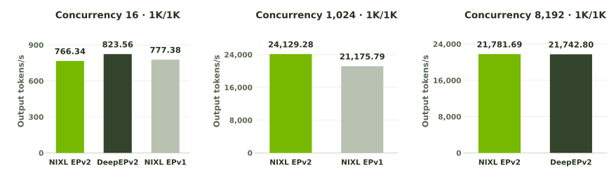
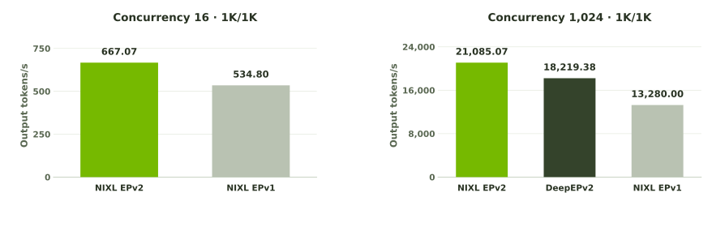
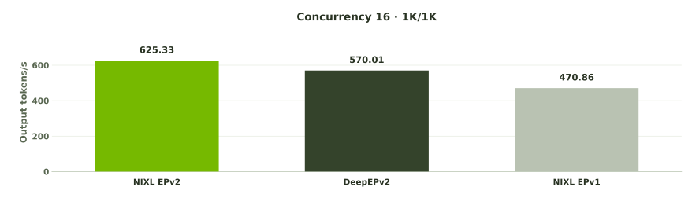

# NVIDIA · EP E2E benchmark

3 deployments · 15 samples

## Contents

[Results](#results) · [Experimental setup](#experimental-setup) · [Configuration](#configuration) · [Single-domain samples](#single-domain-samples) · [Multi-domain samples](#multi-domain-samples)

## Results

### Single domain · 1 × 16

**16 GPUs · 1 NVLink domain · Prefill: 1 × EP8 · Decode: 1 × EP8**

NIXL EPv2 · DeepEPv2 · NIXL EPv1



Aggregate output throughput across all decode GPUs.

| Concurrency | Backend | Output tokens/s ↑ | Median TTFT (s) ↓ | Median End-to-end Latency (s) ↓ |
| :---: | :---: | :---: | :---: | :---: |
| **16** | NIXL EPv2 | **766.34** | **0.278** | **21.34** |
| **16** | DeepEPv2 | **823.56** | **0.286** | **19.87** |
| **16** | NIXL EPv1 | **777.38** | **0.414** | **20.97** |
| **1,024** | NIXL EPv2 | **24,129.28** | **1.389** | **42.03** |
| **1,024** | NIXL EPv1 | **21,175.79** | **0.682** | **47.63** |
| **8,192** | NIXL EPv2 | **21,781.69** | **65.348** | **369.57** |
| **8,192** | DeepEPv2 | **21,742.80** | **70.113** | **373.05** |

### Multi-domain · 2 × 8

**16 GPUs · 2 NVLink domains · Prefill: 1 × EP8 · Decode: 1 × EP8**

Each EP group spans the domains (4+4 GPUs) via RDMA.

NIXL EPv2 · DeepEPv2 · NIXL EPv1



Aggregate output throughput across all decode GPUs.

| Concurrency | Backend | Output tokens/s ↑ | Median TTFT (s) ↓ | Median End-to-end Latency (s) ↓ |
| :---: | :---: | :---: | :---: | :---: |
| **16** | NIXL EPv2 | **667.07** | **0.378** | **24.50** |
| **16** | NIXL EPv1 | **534.80** | **0.758** | **30.48** |
| **1,024** | NIXL EPv2 | **21,085.07** | **1.903** | **48.43** |
| **1,024** | DeepEPv2 | **18,219.38** | **2.681** | **55.21** |
| **1,024** | NIXL EPv1 | **13,280.00** | **1.095** | **71.15** |

### Multi-domain · 4 × 8

**32 GPUs · 4 NVLink domains · Prefill: 3 × EP8 · Decode: 1 × EP8**

Each EP group spans the domains (2+2+2+2 GPUs) via RDMA.

NIXL EPv2 · DeepEPv2 · NIXL EPv1



Aggregate output throughput across all decode GPUs.

| Concurrency | Backend | Output tokens/s ↑ | Median TTFT (s) ↓ | Median End-to-end Latency (s) ↓ |
| :---: | :---: | :---: | :---: | :---: |
| **16** | NIXL EPv2 | **625.33** | **0.427** | **26.14** |
| **16** | DeepEPv2 | **570.01** | **0.524** | **28.67** |
| **16** | NIXL EPv1 | **470.86** | **0.914** | **34.64** |

## Experimental setup

<details>
<summary>Model</summary>

| Setting | Value |
| :--- | :--- |
| Checkpoint | nvidia/DeepSeek-V4-Pro-NVFP4 |
| Revision | 1449d1e641023406daf6b432361486c768aad740 |
| Precision | NVFP4 expert weights and activations (W4A4, group size 16); mixed FP8 dense layers. |
| Generation | Temperature 0; seed 42; MTP disabled. |

</details>

<details>
<summary>Hardware and deployment</summary>

| Setting | Value |
| :--- | :--- |
| Allocation per node | 4 GPUs · 128 requested CPU cores |
| Deployment | Disaggregated prefill and decode; one serving process per GPU. |
| Interconnect | NVLink within each domain; RDMA between domains. |
| Parallelism | EP8 · DPA enabled with 8 ranks · TP1 · PP1 |
| Comparison | Backends run sequentially on the same allocation and GPU placement for each test. |

</details>

<details>
<summary>Benchmark client · AIPerf</summary>

| Setting | Value |
| :--- | :--- |
| Build | 0.13.0 · commit ed212eca0a57f5fd36a6c7747456b2aab6d5700d |
| Workload | Fixed 1,024 input / 1,024 output tokens (1K/1K). |
| Measurement | 600-second request generation, followed by completion of outstanding requests. |
| Warmup | 32 requests at C16; 1,024 requests at C1,024; 8,192 requests at C8,192. Excluded from measurements. |

</details>

<details>
<summary>Serving framework · Dynamo</summary>

| Setting | Value |
| :--- | :--- |
| Build | 1.5.0 · commit b83b1d9304ebfc624709ac46db32b1b6f1ff1615 |
| Routing | KV-aware router; session affinity disabled. |
| Prefill / decode handoff | NixlConnector with GPU buffers transfers the KV cache. |

</details>

<details>
<summary>Inference engine · vLLM</summary>

| Setting | Value |
| :--- | :--- |
| Candidate build | 0.0.0+g2632c8c0e · commit 2632c8c0ee3da621587a8de0628d487327b88963 |
| EP integration | NVFP4 dispatch support for NIXL EPv2; backend-specific CuTeDSL experts. |
| KV cache | FP8 on GPU · block size 256 · context limit 3,072 tokens |
| Memory utilization | 90% in prefill and decode |
| Caching | Cross-request prefix caching and CPU KV offload disabled. |

</details>

## Configuration

### GPU distribution

| Deployment | Total GPUs | Prefill GPUs | Decode GPUs | Within each domain | EP-group distribution |
| :--- | :---: | :---: | :---: | :---: | :---: |
| Single domain · 1 × 16 | 16 | 8 | 8 | 8 prefill + 8 decode | 1 × EP8 prefill + 1 × EP8 decode; 8 GPUs per group across domains |
| Multi-domain · 2 × 8 | 16 | 8 | 8 | 4 prefill + 4 decode | 1 × EP8 prefill + 1 × EP8 decode; 4 + 4 GPUs per group across domains |
| Multi-domain · 4 × 8 | 32 | 24 | 8 | 6 prefill + 2 decode | 3 × EP8 prefill + 1 × EP8 decode; 2 + 2 + 2 + 2 GPUs per group across domains |

One serving process per GPU. Prefill and decode use separate eight-GPU EP groups. Communication uses NVLink within a domain and RDMA between domains.

### Serving configuration

<details>
<summary>Single domain · 1 × 16 · C16 · 1K/1K</summary>

| Setting | NIXL EPv2 | DeepEPv2 | NIXL EPv1 |
| :--- | :---: | :---: | :---: |
| Tensor parallelism (TP) | 1 | 1 | 1 |
| Data-parallel attention (DPA) | On · 8 ranks | On · 8 ranks | On · 8 ranks |
| Pipeline parallelism (PP) | 1 | 1 | 1 |
| Serving processes per prefill GPU | 1 | 1 | 1 |
| Serving processes per decode GPU | 1 | 1 | 1 |
| Prefill max token batch / max sequences | 8,192 / 64 | 8,192 / 64 | 512 / 64 |
| Decode max token batch / max sequences | 1,024 / 1,024 | 1,024 / 1,024 | 512 / 512 |
| Prefill graph mode | Piecewise | Piecewise | Piecewise |
| Prefill graph capture maximum (tokens) | 8,192 | 8,192 | 512 |
| Decode graph mode | Full decode only | Full decode only | Full decode only |
| Max token batch | 512 | 512 | 512 |
| Decode stream interval | 50 | 50 | 50 |
| Expert GEMM | FlashInferCuteDSLExperts | FlashInferCuteDSLExperts | FlashInferCuteDSLBatchedExperts; SwiGLU clamp10 |
| Active SM count | 26 | 26 | Not configured |
| Prefer overlap | On | On | Not applicable |
| Zero-copy · prefill / decode | On / Off | Not applicable | Not applicable |
| EP dispatch format | NVFP4 + FP8 E4M3 scales | BF16 | BF16 |
| EP combine format | BF16 | BF16 | BF16 |

</details>

<details>
<summary>Single domain · 1 × 16 · C1,024 · 1K/1K</summary>

| Setting | NIXL EPv2 | NIXL EPv1 |
| :--- | :---: | :---: |
| Tensor parallelism (TP) | 1 | 1 |
| Data-parallel attention (DPA) | On · 8 ranks | On · 8 ranks |
| Pipeline parallelism (PP) | 1 | 1 |
| Serving processes per prefill GPU | 1 | 1 |
| Serving processes per decode GPU | 1 | 1 |
| Prefill max token batch / max sequences | 8,192 / 64 | 512 / 64 |
| Decode max token batch / max sequences | 1,024 / 1,024 | 512 / 512 |
| Prefill graph mode | Piecewise | Piecewise |
| Prefill graph capture maximum (tokens) | 8,192 | 512 |
| Decode graph mode | Full decode only | Full decode only |
| Max token batch | 1,024 | 512 |
| Decode stream interval | 50 | 50 |
| Expert GEMM | FlashInferCuteDSLExperts | FlashInferCuteDSLBatchedExperts; SwiGLU clamp10 |
| Active SM count | 26 | Not configured |
| Prefer overlap | On | Not applicable |
| Zero-copy · prefill / decode | On / Off | Not applicable |
| EP dispatch format | NVFP4 + FP8 E4M3 scales | BF16 |
| EP combine format | BF16 | BF16 |

</details>

<details>
<summary>Single domain · 1 × 16 · C8,192 · 1K/1K</summary>

| Setting | NIXL EPv2 | DeepEPv2 |
| :--- | :---: | :---: |
| Tensor parallelism (TP) | 1 | 1 |
| Data-parallel attention (DPA) | On · 8 ranks | On · 8 ranks |
| Pipeline parallelism (PP) | 1 | 1 |
| Serving processes per prefill GPU | 1 | 1 |
| Serving processes per decode GPU | 1 | 1 |
| Prefill max token batch / max sequences | 8,192 / 64 | 8,192 / 64 |
| Decode max token batch / max sequences | 1,024 / 1,024 | 1,024 / 1,024 |
| Prefill graph mode | Piecewise | Piecewise |
| Prefill graph capture maximum (tokens) | 8,192 | 8,192 |
| Decode graph mode | Full decode only | Full decode only |
| Max token batch | 1,024 | 1,024 |
| Decode stream interval | 50 | 50 |
| Expert GEMM | FlashInferCuteDSLExperts | FlashInferCuteDSLExperts |
| Active SM count | 26 | 26 |
| Prefer overlap | On | On |
| Zero-copy · prefill / decode | On / On | Not applicable |
| EP dispatch format | NVFP4 + FP8 E4M3 scales | BF16 |
| EP combine format | BF16 | BF16 |

</details>

<details>
<summary>Multi-domain · 2 × 8 · C16 · 1K/1K</summary>

| Setting | NIXL EPv2 | NIXL EPv1 |
| :--- | :---: | :---: |
| Tensor parallelism (TP) | 1 | 1 |
| Data-parallel attention (DPA) | On · 8 ranks | On · 8 ranks |
| Pipeline parallelism (PP) | 1 | 1 |
| Serving processes per prefill GPU | 1 | 1 |
| Serving processes per decode GPU | 1 | 1 |
| Prefill max token batch / max sequences | 8,192 / 64 | 512 / 64 |
| Decode max token batch / max sequences | 1,024 / 1,024 | 512 / 512 |
| Prefill graph mode | Piecewise | Piecewise |
| Prefill graph capture maximum (tokens) | 8,192 | 512 |
| Decode graph mode | Full decode only | Full decode only |
| Max token batch | 1,024 | 512 |
| Decode stream interval | 50 | 50 |
| Expert GEMM | FlashInferCuteDSLExperts | FlashInferCuteDSLBatchedExperts; SwiGLU clamp10 |
| Active SM count | 26 | Not configured |
| Prefer overlap | On | Not applicable |
| Zero-copy · prefill / decode | Off / Off | Not applicable |
| EP dispatch format | NVFP4 + FP8 E4M3 scales | BF16 |
| EP combine format | BF16 | BF16 |

</details>

<details>
<summary>Multi-domain · 2 × 8 · C1,024 · 1K/1K</summary>

| Setting | NIXL EPv2 | DeepEPv2 | NIXL EPv1 |
| :--- | :---: | :---: | :---: |
| Tensor parallelism (TP) | 1 | 1 | 1 |
| Data-parallel attention (DPA) | On · 8 ranks | On · 8 ranks | On · 8 ranks |
| Pipeline parallelism (PP) | 1 | 1 | 1 |
| Serving processes per prefill GPU | 1 | 1 | 1 |
| Serving processes per decode GPU | 1 | 1 | 1 |
| Prefill max token batch / max sequences | 8,192 / 64 | 8,192 / 64 | 512 / 64 |
| Decode max token batch / max sequences | 1,024 / 1,024 | 1,024 / 1,024 | 512 / 512 |
| Prefill graph mode | Piecewise | Piecewise | Piecewise |
| Prefill graph capture maximum (tokens) | 8,192 | 8,192 | 512 |
| Decode graph mode | Full decode only | Full decode only | Full decode only |
| Max token batch | 1,024 | 1,024 | 512 |
| Decode stream interval | 50 | 50 | 50 |
| Expert GEMM | FlashInferCuteDSLExperts | FlashInferCuteDSLExperts | FlashInferCuteDSLBatchedExperts; SwiGLU clamp10 |
| Active SM count | 26 | 26 | Not configured |
| Prefer overlap | On | On | Not applicable |
| Zero-copy · prefill / decode | Off / Off | Not applicable | Not applicable |
| EP dispatch format | NVFP4 + FP8 E4M3 scales | BF16 | BF16 |
| EP combine format | BF16 | BF16 | BF16 |

</details>

<details>
<summary>Multi-domain · 4 × 8 · C16 · 1K/1K</summary>

| Setting | NIXL EPv2 | DeepEPv2 | NIXL EPv1 |
| :--- | :---: | :---: | :---: |
| Tensor parallelism (TP) | 1 | 1 | 1 |
| Data-parallel attention (DPA) | On · 8 ranks | On · 8 ranks | On · 8 ranks |
| Pipeline parallelism (PP) | 1 | 1 | 1 |
| Serving processes per prefill GPU | 1 | 1 | 1 |
| Serving processes per decode GPU | 1 | 1 | 1 |
| Prefill max token batch / max sequences | 8,192 / 64 | 8,192 / 64 | 512 / 64 |
| Decode max token batch / max sequences | 1,024 / 1,024 | 1,024 / 1,024 | 512 / 512 |
| Prefill graph mode | Piecewise | Piecewise | Piecewise |
| Prefill graph capture maximum (tokens) | 8,192 | 8,192 | 512 |
| Decode graph mode | Full decode only | Full decode only | Full decode only |
| Max token batch | 512 | 512 | 512 |
| Decode stream interval | 50 | 50 | 50 |
| Expert GEMM | FlashInferCuteDSLExperts | FlashInferCuteDSLExperts | FlashInferCuteDSLBatchedExperts; SwiGLU clamp10 |
| Active SM count | 26 | 26 | Not configured |
| Prefer overlap | On | On | Not applicable |
| Zero-copy · prefill / decode | Off / Off | Not applicable | Not applicable |
| EP dispatch format | NVFP4 + FP8 E4M3 scales | BF16 | BF16 |
| EP combine format | BF16 | BF16 | BF16 |

</details>

## Single-domain samples

<details>
<summary>Single domain · 1 × 16 · C16 · 1K/1K 3 backends</summary>

#### NIXL EPv2

| Setting | Value |
| :--- | :--- |
| Output throughput | 766.34 tokens/s · all decode GPUs |
| Median TTFT | 0.278 seconds |
| Median End-to-end Latency | 21.34 seconds |

Requests: 464 · Errors: 0 · Duration: 620.00 s, including drain.

**EP wire format, prefill and decode:** dispatch NVFP4 + FP8 E4M3 scales; combine BF16. Packed FP4 activations include one E4M3 scale per 16 values. The wire format is the same with zero-copy On or Off.

#### DeepEPv2

| Setting | Value |
| :--- | :--- |
| Output throughput | 823.56 tokens/s · all decode GPUs |
| Median TTFT | 0.286 seconds |
| Median End-to-end Latency | 19.87 seconds |

Requests: 496 · Errors: 0 · Duration: 616.72 s, including drain.

**EP wire format, prefill and decode:** dispatch BF16; combine BF16. Received BF16 activations are quantized locally to NVFP4 for expert GEMM.

#### NIXL EPv1

| Setting | Value |
| :--- | :--- |
| Output throughput | 777.38 tokens/s · all decode GPUs |
| Median TTFT | 0.414 seconds |
| Median End-to-end Latency | 20.97 seconds |

Requests: 464 · Errors: 0 · Duration: 611.20 s, including drain.

**EP wire format, prefill and decode:** dispatch BF16; combine BF16. Received BF16 activations are quantized locally to NVFP4 for expert GEMM.

16 GPUs · 1 NVLink domain · Prefill: 1 × EP8 · Decode: 1 × EP8

| Setting | NIXL EPv2 | DeepEPv2 | NIXL EPv1 |
| :--- | :---: | :---: | :---: |
| Tensor parallelism (TP) | 1 | 1 | 1 |
| Data-parallel attention (DPA) | On · 8 ranks | On · 8 ranks | On · 8 ranks |
| Pipeline parallelism (PP) | 1 | 1 | 1 |
| Serving processes per prefill GPU | 1 | 1 | 1 |
| Serving processes per decode GPU | 1 | 1 | 1 |
| Prefill max token batch / max sequences | 8,192 / 64 | 8,192 / 64 | 512 / 64 |
| Decode max token batch / max sequences | 1,024 / 1,024 | 1,024 / 1,024 | 512 / 512 |
| Prefill graph mode | Piecewise | Piecewise | Piecewise |
| Prefill graph capture maximum (tokens) | 8,192 | 8,192 | 512 |
| Decode graph mode | Full decode only | Full decode only | Full decode only |
| Max token batch | 512 | 512 | 512 |
| Decode stream interval | 50 | 50 | 50 |
| Expert GEMM | FlashInferCuteDSLExperts | FlashInferCuteDSLExperts | FlashInferCuteDSLBatchedExperts; SwiGLU clamp10 |
| Active SM count | 26 | 26 | Not configured |
| Prefer overlap | On | On | Not applicable |
| Zero-copy · prefill / decode | On / Off | Not applicable | Not applicable |
| EP dispatch format | NVFP4 + FP8 E4M3 scales | BF16 | BF16 |
| EP combine format | BF16 | BF16 | BF16 |

<details>
<summary>GPU distribution and EP groups</summary>

**16 GPUs · 1 NVLink domain · Prefill: 1 × EP8 · Decode: 1 × EP8**

</details>

<details>
<summary>Full configuration</summary>

```json
{
  "model": {
    "dtype": null,
    "precision": {
      "activations": "nvfp4",
      "ep_combine": null,
      "ep_dispatch": null,
      "expert_weights": "nvfp4",
      "label": "NVFP4 W4A4 group16 / mixed FP8 dense loader / FP8 KV",
      "quantization": null
    },
    "repository": "nvidia/DeepSeek-V4-Pro-NVFP4",
    "revision": "1449d1e641023406daf6b432361486c768aad740",
    "routed_experts": 384,
    "served_name": "nvidia/DeepSeek-V4-Pro-NVFP4"
  },
  "workload": {
    "concurrency": 16,
    "context_tokens": 3072,
    "drain_seconds": 600,
    "duration_seconds": 600,
    "input_tokens": 1024,
    "kind": "fixed",
    "maximum_error_fraction": 0.0,
    "output_tokens": 1024,
    "random_seed": 42,
    "request_parameters": {
      "seed": 42,
      "temperature": 0
    },
    "request_timeout_seconds": 600,
    "use_server_token_count": true,
    "warmup_requests": 32
  },
  "topology": {
    "allocation_nodes": 4,
    "decode_ep_groups": 1,
    "decode_gpus": 8,
    "ep_group_size": 8,
    "gpus_per_domain": 16,
    "gpus_per_node": 4,
    "mapping_description": "One 16-GPU NVLink domain contains one EP8 prefill group and one EP8 decode group.",
    "physical_domains": 1,
    "placement": "single_nvlink_domain",
    "prefill_ep_groups": 1,
    "prefill_gpus": 8,
    "ranks_per_ep_group_per_domain": 8,
    "role_gpus_per_domain": {
      "decode": 8,
      "prefill": 8
    },
    "total_gpus": 16
  },
  "backend_effective": {
    "deepep_v2": {
      "applicability": {
        "communication_sms_and_overlap": "NIXL EPv2 and DeepEPv2 only",
        "zero_copy_switch": "NIXL EPv2 only"
      },
      "backend_label": "DeepEPv2",
      "communication_num_sms": 26,
      "communication_prefer_overlap": true,
      "expert_gemm_class": "FlashInferCuteDSLExperts",
      "expert_gemm_implementation": "FlashInferCuteDSLExperts",
      "expert_gemm_module": "vllm.model_executor.layers.fused_moe.experts.flashinfer_cutedsl_moe",
      "nixl_ep_v2_zero_copy_by_role": null,
      "roles": {
        "decode": {
          "engine": {
            "attention_backend": "FLASHINFER_MLA_SPARSE_DSV4",
            "attention_config": {},
            "block_size": 256,
            "enable_prefix_caching": false,
            "extra_engine_args": {
              "cudagraph-metrics": true,
              "data-parallel-backend": "mp",
              "enable-ep-weight-filter": true,
              "safetensors-load-strategy": "lazy",
              "seed": 42,
              "stream-interval": 50
            },
            "gpu_memory_utilization": 0.9,
            "graph": {
              "compilation_config": {
                "cudagraph_capture_sizes": [
                  1,
                  2,
                  4,
                  8,
                  16,
                  32,
                  64,
                  128,
                  256,
                  512
                ],
                "cudagraph_mode": "FULL_DECODE_ONLY",
                "max_cudagraph_capture_size": 512,
                "mode": 0
              },
              "mode": "cuda_graph"
            },
            "kv_cache_dtype": "fp8",
            "max_model_len": 3072,
            "max_num_batched_tokens": 1024,
            "max_num_seqs": 1024,
            "moe_backend": "flashinfer_cutedsl",
            "serving_process_layout": "gpu_external"
          },
          "environment": {
            "VLLM_DEEPEP_V2_NUM_SMS": "26",
            "VLLM_DEEPEP_V2_PREFER_OVERLAP": "1"
          },
          "gpus_per_worker": 8,
          "parallelism": {
            "data_parallel_attention": true,
            "data_parallel_size": 8,
            "enable_expert_parallel": true,
            "pipeline_parallel_size": 1,
            "tensor_parallel_size": 1
          },
          "serving_processes_per_gpu": 1,
          "workers": 1
        },
        "prefill": {
          "engine": {
            "attention_backend": "FLASHINFER_MLA_SPARSE_DSV4",
            "attention_config": {},
            "block_size": 256,
            "enable_prefix_caching": false,
            "extra_engine_args": {
              "data-parallel-backend": "mp",
              "enable-ep-weight-filter": true,
              "no-enable-flashinfer-autotune": true,
              "safetensors-load-strategy": "lazy",
              "seed": 42
            },
            "gpu_memory_utilization": 0.9,
            "graph": {
              "compilation_config": {
                "cudagraph_capture_sizes": [
                  1,
                  2,
                  4,
                  8,
                  16,
                  32,
                  64,
                  128,
                  256,
                  512,
                  1024,
                  2048,
                  4096,
                  8192
                ],
                "cudagraph_mode": "PIECEWISE",
                "max_cudagraph_capture_size": 8192,
                "mode": 0
              },
              "mode": "cuda_graph"
            },
            "kv_cache_dtype": "fp8",
            "max_model_len": 3072,
            "max_num_batched_tokens": 8192,
            "max_num_seqs": 64,
            "moe_backend": "flashinfer_cutedsl",
            "serving_process_layout": "gpu_external"
          },
          "environment": {
            "VLLM_DEEPEP_V2_NUM_SMS": "26",
            "VLLM_DEEPEP_V2_PREFER_OVERLAP": "1"
          },
          "gpus_per_worker": 8,
          "parallelism": {
            "data_parallel_attention": true,
            "data_parallel_size": 8,
            "enable_expert_parallel": true,
            "pipeline_parallel_size": 1,
            "tensor_parallel_size": 1
          },
          "serving_processes_per_gpu": 1,
          "workers": 1
        }
      }
    },
    "nixl_ep": {
      "applicability": {
        "communication_sms_and_overlap": "NIXL EPv2 and DeepEPv2 only",
        "zero_copy_switch": "NIXL EPv2 only"
      },
      "backend_label": "NIXL EPv1",
      "communication_num_sms": null,
      "communication_prefer_overlap": null,
      "expert_gemm_class": "FlashInferCuteDSLBatchedExperts",
      "expert_gemm_implementation": "FlashInferCuteDSLBatchedExperts; SwiGLU clamp10",
      "expert_gemm_module": "vllm.model_executor.layers.fused_moe.experts.flashinfer_cutedsl_batched_moe",
      "n1_effective_overrides": {
        "capture_maximum": 512,
        "chunked_prefill": true,
        "required_expert_class": "FlashInferCuteDSLBatchedExperts",
        "role_token_capacity": {
          "decode": 512,
          "prefill": 512
        },
        "swiglu_limit": 10
      },
      "nixl_ep_v2_zero_copy_by_role": null,
      "roles": {
        "decode": {
          "engine": {
            "attention_backend": "FLASHINFER_MLA_SPARSE_DSV4",
            "attention_config": {},
            "block_size": 256,
            "enable_prefix_caching": false,
            "extra_engine_args": {
              "cudagraph-metrics": true,
              "data-parallel-backend": "mp",
              "enable-chunked-prefill": true,
              "enable-ep-weight-filter": true,
              "safetensors-load-strategy": "lazy",
              "seed": 42,
              "stream-interval": 50
            },
            "gpu_memory_utilization": 0.9,
            "graph": {
              "compilation_config": {
                "cudagraph_capture_sizes": [
                  1,
                  2,
                  4,
                  8,
                  16,
                  32,
                  64,
                  128,
                  256,
                  512
                ],
                "cudagraph_mode": "FULL_DECODE_ONLY",
                "max_cudagraph_capture_size": 512,
                "mode": 0
              },
              "mode": "cuda_graph"
            },
            "kv_cache_dtype": "fp8",
            "max_model_len": 3072,
            "max_num_batched_tokens": 512,
            "max_num_seqs": 512,
            "moe_backend": "flashinfer_cutedsl",
            "serving_process_layout": "gpu_external"
          },
          "environment": {},
          "gpus_per_worker": 8,
          "parallelism": {
            "data_parallel_attention": true,
            "data_parallel_size": 8,
            "enable_expert_parallel": true,
            "pipeline_parallel_size": 1,
            "tensor_parallel_size": 1
          },
          "serving_processes_per_gpu": 1,
          "workers": 1
        },
        "prefill": {
          "engine": {
            "attention_backend": "FLASHINFER_MLA_SPARSE_DSV4",
            "attention_config": {},
            "block_size": 256,
            "enable_prefix_caching": false,
            "extra_engine_args": {
              "data-parallel-backend": "mp",
              "enable-chunked-prefill": true,
              "enable-ep-weight-filter": true,
              "no-enable-flashinfer-autotune": true,
              "safetensors-load-strategy": "lazy",
              "seed": 42
            },
            "gpu_memory_utilization": 0.9,
            "graph": {
              "compilation_config": {
                "cudagraph_capture_sizes": [
                  1,
                  2,
                  4,
                  8,
                  16,
                  32,
                  64,
                  128,
                  256,
                  512
                ],
                "cudagraph_mode": "PIECEWISE",
                "max_cudagraph_capture_size": 512,
                "mode": 0
              },
              "mode": "cuda_graph"
            },
            "kv_cache_dtype": "fp8",
            "max_model_len": 3072,
            "max_num_batched_tokens": 512,
            "max_num_seqs": 64,
            "moe_backend": "flashinfer_cutedsl",
            "serving_process_layout": "gpu_external"
          },
          "environment": {},
          "gpus_per_worker": 8,
          "parallelism": {
            "data_parallel_attention": true,
            "data_parallel_size": 8,
            "enable_expert_parallel": true,
            "pipeline_parallel_size": 1,
            "tensor_parallel_size": 1
          },
          "serving_processes_per_gpu": 1,
          "workers": 1
        }
      }
    },
    "nixl_ep_v2": {
      "applicability": {
        "communication_sms_and_overlap": "NIXL EPv2 and DeepEPv2 only",
        "zero_copy_switch": "NIXL EPv2 only"
      },
      "backend_label": "NIXL EPv2",
      "communication_num_sms": 26,
      "communication_prefer_overlap": true,
      "expert_gemm_class": "FlashInferCuteDSLExperts",
      "expert_gemm_implementation": "FlashInferCuteDSLExperts",
      "expert_gemm_module": "vllm.model_executor.layers.fused_moe.experts.flashinfer_cutedsl_moe",
      "nixl_ep_v2_zero_copy_by_role": {
        "decode": false,
        "prefill": true
      },
      "roles": {
        "decode": {
          "engine": {
            "attention_backend": "FLASHINFER_MLA_SPARSE_DSV4",
            "attention_config": {},
            "block_size": 256,
            "enable_prefix_caching": false,
            "extra_engine_args": {
              "cudagraph-metrics": true,
              "data-parallel-backend": "mp",
              "enable-ep-weight-filter": true,
              "safetensors-load-strategy": "lazy",
              "seed": 42,
              "stream-interval": 50
            },
            "gpu_memory_utilization": 0.9,
            "graph": {
              "compilation_config": {
                "cudagraph_capture_sizes": [
                  1,
                  2,
                  4,
                  8,
                  16,
                  32,
                  64,
                  128,
                  256,
                  512
                ],
                "cudagraph_mode": "FULL_DECODE_ONLY",
                "max_cudagraph_capture_size": 512,
                "mode": 0
              },
              "mode": "cuda_graph"
            },
            "kv_cache_dtype": "fp8",
            "max_model_len": 3072,
            "max_num_batched_tokens": 1024,
            "max_num_seqs": 1024,
            "moe_backend": "flashinfer_cutedsl",
            "serving_process_layout": "gpu_external"
          },
          "environment": {
            "VLLM_NIXL_EP_V2_NUM_SMS": "26",
            "VLLM_NIXL_EP_V2_PREFER_OVERLAP": "1"
          },
          "gpus_per_worker": 8,
          "parallelism": {
            "data_parallel_attention": true,
            "data_parallel_size": 8,
            "enable_expert_parallel": true,
            "pipeline_parallel_size": 1,
            "tensor_parallel_size": 1
          },
          "serving_processes_per_gpu": 1,
          "workers": 1
        },
        "prefill": {
          "engine": {
            "attention_backend": "FLASHINFER_MLA_SPARSE_DSV4",
            "attention_config": {},
            "block_size": 256,
            "enable_prefix_caching": false,
            "extra_engine_args": {
              "data-parallel-backend": "mp",
              "enable-ep-weight-filter": true,
              "no-enable-flashinfer-autotune": true,
              "safetensors-load-strategy": "lazy",
              "seed": 42
            },
            "gpu_memory_utilization": 0.9,
            "graph": {
              "compilation_config": {
                "cudagraph_capture_sizes": [
                  1,
                  2,
                  4,
                  8,
                  16,
                  32,
                  64,
                  128,
                  256,
                  512,
                  1024,
                  2048,
                  4096,
                  8192
                ],
                "cudagraph_mode": "PIECEWISE",
                "max_cudagraph_capture_size": 8192,
                "mode": 0
              },
              "mode": "cuda_graph"
            },
            "kv_cache_dtype": "fp8",
            "max_model_len": 3072,
            "max_num_batched_tokens": 8192,
            "max_num_seqs": 64,
            "moe_backend": "flashinfer_cutedsl",
            "serving_process_layout": "gpu_external"
          },
          "environment": {
            "VLLM_NIXL_EP_V2_NUM_SMS": "26",
            "VLLM_NIXL_EP_V2_PREFER_OVERLAP": "1"
          },
          "gpus_per_worker": 8,
          "parallelism": {
            "data_parallel_attention": true,
            "data_parallel_size": 8,
            "enable_expert_parallel": true,
            "pipeline_parallel_size": 1,
            "tensor_parallel_size": 1
          },
          "serving_processes_per_gpu": 1,
          "workers": 1
        }
      }
    }
  },
  "launch": {
    "correctness_qualification": null,
    "decode_compute_policy": null,
    "execution_mode": "performance",
    "expert_compute_policy": "nvfp4_cutedsl_v1",
    "gsm8k_policy": "all_backends_skipped_v1",
    "nixl_ep_timeout_ms": 300000,
    "nixl_ep_zero_copy": true,
    "nixl_ep_zero_copy_by_role": {
      "decode": false,
      "prefill": true
    },
    "post_performance_profile": null,
    "quiescing_seconds": 60,
    "require_single_nvlink_domain": false,
    "serving_port_policy": "backend_ranges_3770_stride1024_effective_probe_v1"
  },
  "runtime": {
    "aiperf": {
      "source_revision": "ed212eca0a57f5fd36a6c7747456b2aab6d5700d",
      "version": "0.13.0"
    },
    "dynamo": {
      "source_revision": "b83b1d9304ebfc624709ac46db32b1b6f1ff1615",
      "version": "1.5.0"
    },
    "vllm": {
      "source_revision": "2632c8c0ee3da621587a8de0628d487327b88963",
      "version": "0.0.0+g2632c8c0e"
    },
    "environment": {
      "HF_DATASETS_OFFLINE": "1",
      "HF_HUB_OFFLINE": "1",
      "MAX_JOBS": "8",
      "NVCC_THREADS": "1",
      "UCX_RCACHE_MAX_UNRELEASED": "1024",
      "VLLM_ENGINE_READY_TIMEOUT_S": "4500"
    }
  },
  "communication": {
    "communication_policy": "selectable_backends",
    "kv_transfer": {
      "buffer_device": "cuda",
      "connector": "NixlConnector",
      "enabled": true,
      "extra_config": {},
      "per_role": {
        "decode": {
          "kv_connector": "NixlConnector",
          "kv_role": "kv_consumer"
        },
        "prefill": {
          "kv_connector": "NixlConnector",
          "kv_role": "kv_producer"
        }
      }
    },
    "kv_offload": {
      "backend": null,
      "enabled": false,
      "options": {},
      "storage": "dram"
    },
    "mtp": {
      "acceptance": {
        "length": null,
        "policy": "real",
        "probabilities": null,
        "provenance": null
      },
      "enabled": false,
      "method": "mtp",
      "num_tokens": 0
    },
    "router": {
      "environment": {},
      "extra_args": {},
      "mode": "kv",
      "session": {
        "from_correlation_id": false,
        "mode": "disabled",
        "ttl_seconds": null
      }
    },
    "timeouts": {
      "benchmark_seconds": 1500,
      "correctness_seconds": 1200,
      "preparation_seconds": 1200,
      "shutdown_seconds": 60,
      "startup_seconds": 4500
    }
  }
}
```

</details>

</details>

<details>
<summary>Single domain · 1 × 16 · C1,024 · 1K/1K 2 backends</summary>

#### NIXL EPv2

| Setting | Value |
| :--- | :--- |
| Output throughput | 24,129.28 tokens/s · all decode GPUs |
| Median TTFT | 1.389 seconds |
| Median End-to-end Latency | 42.03 seconds |

Requests: 15,093 · Errors: 0 · Duration: 640.51 s, including drain.

**EP wire format, prefill and decode:** dispatch NVFP4 + FP8 E4M3 scales; combine BF16. Packed FP4 activations include one E4M3 scale per 16 values. The wire format is the same with zero-copy On or Off.

#### NIXL EPv1

| Setting | Value |
| :--- | :--- |
| Output throughput | 21,175.79 tokens/s · all decode GPUs |
| Median TTFT | 0.682 seconds |
| Median End-to-end Latency | 47.63 seconds |

Requests: 13,312 · Errors: 0 · Duration: 643.73 s, including drain.

**EP wire format, prefill and decode:** dispatch BF16; combine BF16. Received BF16 activations are quantized locally to NVFP4 for expert GEMM.

16 GPUs · 1 NVLink domain · Prefill: 1 × EP8 · Decode: 1 × EP8

| Setting | NIXL EPv2 | NIXL EPv1 |
| :--- | :---: | :---: |
| Tensor parallelism (TP) | 1 | 1 |
| Data-parallel attention (DPA) | On · 8 ranks | On · 8 ranks |
| Pipeline parallelism (PP) | 1 | 1 |
| Serving processes per prefill GPU | 1 | 1 |
| Serving processes per decode GPU | 1 | 1 |
| Prefill max token batch / max sequences | 8,192 / 64 | 512 / 64 |
| Decode max token batch / max sequences | 1,024 / 1,024 | 512 / 512 |
| Prefill graph mode | Piecewise | Piecewise |
| Prefill graph capture maximum (tokens) | 8,192 | 512 |
| Decode graph mode | Full decode only | Full decode only |
| Max token batch | 1,024 | 512 |
| Decode stream interval | 50 | 50 |
| Expert GEMM | FlashInferCuteDSLExperts | FlashInferCuteDSLBatchedExperts; SwiGLU clamp10 |
| Active SM count | 26 | Not configured |
| Prefer overlap | On | Not applicable |
| Zero-copy · prefill / decode | On / Off | Not applicable |
| EP dispatch format | NVFP4 + FP8 E4M3 scales | BF16 |
| EP combine format | BF16 | BF16 |

<details>
<summary>GPU distribution and EP groups</summary>

**16 GPUs · 1 NVLink domain · Prefill: 1 × EP8 · Decode: 1 × EP8**

</details>

<details>
<summary>Full configuration</summary>

```json
{
  "model": {
    "dtype": null,
    "precision": {
      "activations": "nvfp4",
      "ep_combine": null,
      "ep_dispatch": null,
      "expert_weights": "nvfp4",
      "label": "NVFP4 W4A4 group16 / mixed FP8 dense loader / FP8 KV",
      "quantization": null
    },
    "repository": "nvidia/DeepSeek-V4-Pro-NVFP4",
    "revision": "1449d1e641023406daf6b432361486c768aad740",
    "routed_experts": 384,
    "served_name": "nvidia/DeepSeek-V4-Pro-NVFP4"
  },
  "workload": {
    "concurrency": 1024,
    "context_tokens": 3072,
    "drain_seconds": 600,
    "duration_seconds": 600,
    "input_tokens": 1024,
    "kind": "fixed",
    "maximum_error_fraction": 0.0,
    "output_tokens": 1024,
    "random_seed": 42,
    "request_parameters": {
      "seed": 42,
      "temperature": 0
    },
    "request_timeout_seconds": 600,
    "use_server_token_count": true,
    "warmup_requests": 1024
  },
  "topology": {
    "allocation_nodes": 4,
    "decode_ep_groups": 1,
    "decode_gpus": 8,
    "ep_group_size": 8,
    "gpus_per_domain": 16,
    "gpus_per_node": 4,
    "mapping_description": "One 16-GPU NVLink domain contains one EP8 prefill group and one EP8 decode group.",
    "physical_domains": 1,
    "placement": "single_nvlink_domain",
    "prefill_ep_groups": 1,
    "prefill_gpus": 8,
    "ranks_per_ep_group_per_domain": 8,
    "role_gpus_per_domain": {
      "decode": 8,
      "prefill": 8
    },
    "total_gpus": 16
  },
  "backend_effective": {
    "nixl_ep": {
      "applicability": {
        "communication_sms_and_overlap": "NIXL EPv2 and DeepEPv2 only",
        "zero_copy_switch": "NIXL EPv2 only"
      },
      "backend_label": "NIXL EPv1",
      "communication_num_sms": null,
      "communication_prefer_overlap": null,
      "expert_gemm_class": "FlashInferCuteDSLBatchedExperts",
      "expert_gemm_implementation": "FlashInferCuteDSLBatchedExperts; SwiGLU clamp10",
      "expert_gemm_module": "vllm.model_executor.layers.fused_moe.experts.flashinfer_cutedsl_batched_moe",
      "n1_effective_overrides": {
        "capture_maximum": 512,
        "chunked_prefill": true,
        "required_expert_class": "FlashInferCuteDSLBatchedExperts",
        "role_token_capacity": {
          "decode": 512,
          "prefill": 512
        },
        "swiglu_limit": 10
      },
      "nixl_ep_v2_zero_copy_by_role": null,
      "roles": {
        "decode": {
          "engine": {
            "attention_backend": "FLASHINFER_MLA_SPARSE_DSV4",
            "attention_config": {},
            "block_size": 256,
            "enable_prefix_caching": false,
            "extra_engine_args": {
              "cudagraph-metrics": true,
              "data-parallel-backend": "mp",
              "enable-chunked-prefill": true,
              "enable-ep-weight-filter": true,
              "safetensors-load-strategy": "lazy",
              "seed": 42,
              "stream-interval": 50
            },
            "gpu_memory_utilization": 0.9,
            "graph": {
              "compilation_config": {
                "cudagraph_capture_sizes": [
                  1,
                  2,
                  4,
                  8,
                  16,
                  32,
                  64,
                  128,
                  256,
                  512
                ],
                "cudagraph_mode": "FULL_DECODE_ONLY",
                "max_cudagraph_capture_size": 512,
                "mode": 0
              },
              "mode": "cuda_graph"
            },
            "kv_cache_dtype": "fp8",
            "max_model_len": 3072,
            "max_num_batched_tokens": 512,
            "max_num_seqs": 512,
            "moe_backend": "flashinfer_cutedsl",
            "serving_process_layout": "gpu_external"
          },
          "environment": {},
          "gpus_per_worker": 8,
          "parallelism": {
            "data_parallel_attention": true,
            "data_parallel_size": 8,
            "enable_expert_parallel": true,
            "pipeline_parallel_size": 1,
            "tensor_parallel_size": 1
          },
          "serving_processes_per_gpu": 1,
          "workers": 1
        },
        "prefill": {
          "engine": {
            "attention_backend": "FLASHINFER_MLA_SPARSE_DSV4",
            "attention_config": {},
            "block_size": 256,
            "enable_prefix_caching": false,
            "extra_engine_args": {
              "data-parallel-backend": "mp",
              "enable-chunked-prefill": true,
              "enable-ep-weight-filter": true,
              "no-enable-flashinfer-autotune": true,
              "safetensors-load-strategy": "lazy",
              "seed": 42
            },
            "gpu_memory_utilization": 0.9,
            "graph": {
              "compilation_config": {
                "cudagraph_capture_sizes": [
                  1,
                  2,
                  4,
                  8,
                  16,
                  32,
                  64,
                  128,
                  256,
                  512
                ],
                "cudagraph_mode": "PIECEWISE",
                "max_cudagraph_capture_size": 512,
                "mode": 0
              },
              "mode": "cuda_graph"
            },
            "kv_cache_dtype": "fp8",
            "max_model_len": 3072,
            "max_num_batched_tokens": 512,
            "max_num_seqs": 64,
            "moe_backend": "flashinfer_cutedsl",
            "serving_process_layout": "gpu_external"
          },
          "environment": {},
          "gpus_per_worker": 8,
          "parallelism": {
            "data_parallel_attention": true,
            "data_parallel_size": 8,
            "enable_expert_parallel": true,
            "pipeline_parallel_size": 1,
            "tensor_parallel_size": 1
          },
          "serving_processes_per_gpu": 1,
          "workers": 1
        }
      }
    },
    "nixl_ep_v2": {
      "applicability": {
        "communication_sms_and_overlap": "NIXL EPv2 and DeepEPv2 only",
        "zero_copy_switch": "NIXL EPv2 only"
      },
      "backend_label": "NIXL EPv2",
      "communication_num_sms": 26,
      "communication_prefer_overlap": true,
      "expert_gemm_class": "FlashInferCuteDSLExperts",
      "expert_gemm_implementation": "FlashInferCuteDSLExperts",
      "expert_gemm_module": "vllm.model_executor.layers.fused_moe.experts.flashinfer_cutedsl_moe",
      "nixl_ep_v2_zero_copy_by_role": {
        "decode": false,
        "prefill": true
      },
      "roles": {
        "decode": {
          "engine": {
            "attention_backend": "FLASHINFER_MLA_SPARSE_DSV4",
            "attention_config": {},
            "block_size": 256,
            "enable_prefix_caching": false,
            "extra_engine_args": {
              "cudagraph-metrics": true,
              "data-parallel-backend": "mp",
              "enable-ep-weight-filter": true,
              "safetensors-load-strategy": "lazy",
              "seed": 42,
              "stream-interval": 50
            },
            "gpu_memory_utilization": 0.9,
            "graph": {
              "compilation_config": {
                "cudagraph_capture_sizes": [
                  1,
                  2,
                  4,
                  8,
                  16,
                  32,
                  64,
                  128,
                  256,
                  512,
                  1024
                ],
                "cudagraph_mode": "FULL_DECODE_ONLY",
                "max_cudagraph_capture_size": 1024,
                "mode": 0
              },
              "mode": "cuda_graph"
            },
            "kv_cache_dtype": "fp8",
            "max_model_len": 3072,
            "max_num_batched_tokens": 1024,
            "max_num_seqs": 1024,
            "moe_backend": "flashinfer_cutedsl",
            "serving_process_layout": "gpu_external"
          },
          "environment": {
            "VLLM_NIXL_EP_V2_NUM_SMS": "26",
            "VLLM_NIXL_EP_V2_PREFER_OVERLAP": "1"
          },
          "gpus_per_worker": 8,
          "parallelism": {
            "data_parallel_attention": true,
            "data_parallel_size": 8,
            "enable_expert_parallel": true,
            "pipeline_parallel_size": 1,
            "tensor_parallel_size": 1
          },
          "serving_processes_per_gpu": 1,
          "workers": 1
        },
        "prefill": {
          "engine": {
            "attention_backend": "FLASHINFER_MLA_SPARSE_DSV4",
            "attention_config": {},
            "block_size": 256,
            "enable_prefix_caching": false,
            "extra_engine_args": {
              "data-parallel-backend": "mp",
              "enable-ep-weight-filter": true,
              "no-enable-flashinfer-autotune": true,
              "safetensors-load-strategy": "lazy",
              "seed": 42
            },
            "gpu_memory_utilization": 0.9,
            "graph": {
              "compilation_config": {
                "cudagraph_capture_sizes": [
                  1,
                  2,
                  4,
                  8,
                  16,
                  32,
                  64,
                  128,
                  256,
                  512,
                  1024,
                  2048,
                  4096,
                  8192
                ],
                "cudagraph_mode": "PIECEWISE",
                "max_cudagraph_capture_size": 8192,
                "mode": 0
              },
              "mode": "cuda_graph"
            },
            "kv_cache_dtype": "fp8",
            "max_model_len": 3072,
            "max_num_batched_tokens": 8192,
            "max_num_seqs": 64,
            "moe_backend": "flashinfer_cutedsl",
            "serving_process_layout": "gpu_external"
          },
          "environment": {
            "VLLM_NIXL_EP_V2_NUM_SMS": "26",
            "VLLM_NIXL_EP_V2_PREFER_OVERLAP": "1"
          },
          "gpus_per_worker": 8,
          "parallelism": {
            "data_parallel_attention": true,
            "data_parallel_size": 8,
            "enable_expert_parallel": true,
            "pipeline_parallel_size": 1,
            "tensor_parallel_size": 1
          },
          "serving_processes_per_gpu": 1,
          "workers": 1
        }
      }
    }
  },
  "launch": {
    "correctness_qualification": null,
    "decode_compute_policy": null,
    "execution_mode": "performance",
    "expert_compute_policy": "nvfp4_cutedsl_v1",
    "gsm8k_policy": "all_backends_skipped_v1",
    "nixl_ep_timeout_ms": 300000,
    "nixl_ep_zero_copy": true,
    "nixl_ep_zero_copy_by_role": {
      "decode": false,
      "prefill": true
    },
    "post_performance_profile": null,
    "quiescing_seconds": 60,
    "require_single_nvlink_domain": false,
    "serving_port_policy": "backend_ranges_3770_stride1024_effective_probe_v1"
  },
  "runtime": {
    "aiperf": {
      "source_revision": "ed212eca0a57f5fd36a6c7747456b2aab6d5700d",
      "version": "0.13.0"
    },
    "dynamo": {
      "source_revision": "b83b1d9304ebfc624709ac46db32b1b6f1ff1615",
      "version": "1.5.0"
    },
    "vllm": {
      "source_revision": "2632c8c0ee3da621587a8de0628d487327b88963",
      "version": "0.0.0+g2632c8c0e"
    },
    "environment": {
      "HF_DATASETS_OFFLINE": "1",
      "HF_HUB_OFFLINE": "1",
      "MAX_JOBS": "8",
      "NVCC_THREADS": "1",
      "UCX_RCACHE_MAX_UNRELEASED": "1024",
      "VLLM_ENGINE_READY_TIMEOUT_S": "4500"
    }
  },
  "communication": {
    "communication_policy": "selectable_backends",
    "kv_transfer": {
      "buffer_device": "cuda",
      "connector": "NixlConnector",
      "enabled": true,
      "extra_config": {},
      "per_role": {
        "decode": {
          "kv_connector": "NixlConnector",
          "kv_connector_extra_config": {
            "kv_lease_duration": 1200
          },
          "kv_role": "kv_consumer"
        },
        "prefill": {
          "kv_connector": "NixlConnector",
          "kv_connector_extra_config": {
            "kv_lease_duration": 1200
          },
          "kv_role": "kv_producer"
        }
      }
    },
    "kv_offload": {
      "backend": null,
      "enabled": false,
      "options": {},
      "storage": "dram"
    },
    "mtp": {
      "acceptance": {
        "length": null,
        "policy": "real",
        "probabilities": null,
        "provenance": null
      },
      "enabled": false,
      "method": "mtp",
      "num_tokens": 0
    },
    "router": {
      "environment": {},
      "extra_args": {},
      "mode": "kv",
      "session": {
        "from_correlation_id": false,
        "mode": "disabled",
        "ttl_seconds": null
      }
    },
    "timeouts": {
      "benchmark_seconds": 1860,
      "correctness_seconds": 1200,
      "preparation_seconds": 1200,
      "shutdown_seconds": 60,
      "startup_seconds": 4500
    }
  }
}
```

</details>

</details>

<details>
<summary>Single domain · 1 × 16 · C8,192 · 1K/1K 2 backends</summary>

#### NIXL EPv2

| Setting | Value |
| :--- | :--- |
| Output throughput | 21,781.69 tokens/s · all decode GPUs |
| Median TTFT | 65.348 seconds |
| Median End-to-end Latency | 369.57 seconds |

Requests: 16,574 · Errors: 0 · Duration: 779.17 s, including drain.

**EP wire format, prefill and decode:** dispatch NVFP4 + FP8 E4M3 scales; combine BF16. Packed FP4 activations include one E4M3 scale per 16 values. The wire format is the same with zero-copy On or Off.

#### DeepEPv2

| Setting | Value |
| :--- | :--- |
| Output throughput | 21,742.80 tokens/s · all decode GPUs |
| Median TTFT | 70.113 seconds |
| Median End-to-end Latency | 373.05 seconds |

Requests: 16,749 · Errors: 0 · Duration: 788.81 s, including drain.

**EP wire format, prefill and decode:** dispatch BF16; combine BF16. Received BF16 activations are quantized locally to NVFP4 for expert GEMM.

16 GPUs · 1 NVLink domain · Prefill: 1 × EP8 · Decode: 1 × EP8

| Setting | NIXL EPv2 | DeepEPv2 |
| :--- | :---: | :---: |
| Tensor parallelism (TP) | 1 | 1 |
| Data-parallel attention (DPA) | On · 8 ranks | On · 8 ranks |
| Pipeline parallelism (PP) | 1 | 1 |
| Serving processes per prefill GPU | 1 | 1 |
| Serving processes per decode GPU | 1 | 1 |
| Prefill max token batch / max sequences | 8,192 / 64 | 8,192 / 64 |
| Decode max token batch / max sequences | 1,024 / 1,024 | 1,024 / 1,024 |
| Prefill graph mode | Piecewise | Piecewise |
| Prefill graph capture maximum (tokens) | 8,192 | 8,192 |
| Decode graph mode | Full decode only | Full decode only |
| Max token batch | 1,024 | 1,024 |
| Decode stream interval | 50 | 50 |
| Expert GEMM | FlashInferCuteDSLExperts | FlashInferCuteDSLExperts |
| Active SM count | 26 | 26 |
| Prefer overlap | On | On |
| Zero-copy · prefill / decode | On / On | Not applicable |
| EP dispatch format | NVFP4 + FP8 E4M3 scales | BF16 |
| EP combine format | BF16 | BF16 |

<details>
<summary>GPU distribution and EP groups</summary>

**16 GPUs · 1 NVLink domain · Prefill: 1 × EP8 · Decode: 1 × EP8**

</details>

<details>
<summary>Full configuration</summary>

```json
{
  "model": {
    "dtype": null,
    "precision": {
      "activations": "nvfp4",
      "ep_combine": null,
      "ep_dispatch": null,
      "expert_weights": "nvfp4",
      "label": "NVFP4 W4A4 group16 / mixed FP8 dense loader / FP8 KV",
      "quantization": null
    },
    "repository": "nvidia/DeepSeek-V4-Pro-NVFP4",
    "revision": "1449d1e641023406daf6b432361486c768aad740",
    "routed_experts": 384,
    "served_name": "nvidia/DeepSeek-V4-Pro-NVFP4"
  },
  "workload": {
    "concurrency": 8192,
    "context_tokens": 3072,
    "drain_seconds": 600,
    "duration_seconds": 600,
    "input_tokens": 1024,
    "kind": "fixed",
    "maximum_error_fraction": 0.0,
    "output_tokens": 1024,
    "random_seed": 42,
    "request_parameters": {
      "seed": 42,
      "temperature": 0
    },
    "request_timeout_seconds": 600,
    "use_server_token_count": true,
    "warmup_concurrency_ramp_seconds": 32,
    "warmup_requests": 8192
  },
  "topology": {
    "allocation_nodes": 4,
    "decode_ep_groups": 1,
    "decode_gpus": 8,
    "ep_group_size": 8,
    "gpus_per_domain": 16,
    "gpus_per_node": 4,
    "mapping_description": "One 16-GPU NVLink domain contains one EP8 prefill group and one EP8 decode group.",
    "physical_domains": 1,
    "placement": "single_nvlink_domain",
    "prefill_ep_groups": 1,
    "prefill_gpus": 8,
    "ranks_per_ep_group_per_domain": 8,
    "role_gpus_per_domain": {
      "decode": 8,
      "prefill": 8
    },
    "total_gpus": 16
  },
  "backend_effective": {
    "deepep_v2": {
      "applicability": {
        "communication_sms_and_overlap": "NIXL EPv2 and DeepEPv2 only",
        "zero_copy_switch": "NIXL EPv2 only"
      },
      "backend_label": "DeepEPv2",
      "communication_num_sms": 26,
      "communication_prefer_overlap": true,
      "expert_gemm_class": "FlashInferCuteDSLExperts",
      "expert_gemm_implementation": "FlashInferCuteDSLExperts",
      "expert_gemm_module": "vllm.model_executor.layers.fused_moe.experts.flashinfer_cutedsl_moe",
      "nixl_ep_v2_zero_copy_by_role": null,
      "roles": {
        "decode": {
          "engine": {
            "attention_backend": "FLASHINFER_MLA_SPARSE_DSV4",
            "attention_config": {},
            "block_size": 256,
            "enable_prefix_caching": false,
            "extra_engine_args": {
              "cudagraph-metrics": true,
              "data-parallel-backend": "mp",
              "enable-ep-weight-filter": true,
              "safetensors-load-strategy": "lazy",
              "seed": 42,
              "stream-interval": 50
            },
            "gpu_memory_utilization": 0.9,
            "graph": {
              "compilation_config": {
                "cudagraph_capture_sizes": [
                  1,
                  2,
                  4,
                  8,
                  16,
                  32,
                  64,
                  128,
                  256,
                  512,
                  1024
                ],
                "cudagraph_mode": "FULL_DECODE_ONLY",
                "max_cudagraph_capture_size": 1024,
                "mode": 0
              },
              "mode": "cuda_graph"
            },
            "kv_cache_dtype": "fp8",
            "max_model_len": 3072,
            "max_num_batched_tokens": 1024,
            "max_num_seqs": 1024,
            "moe_backend": "flashinfer_cutedsl",
            "serving_process_layout": "gpu_external"
          },
          "environment": {
            "VLLM_DEEPEP_V2_NUM_SMS": "26",
            "VLLM_DEEPEP_V2_PREFER_OVERLAP": "1"
          },
          "gpus_per_worker": 8,
          "parallelism": {
            "data_parallel_attention": true,
            "data_parallel_size": 8,
            "enable_expert_parallel": true,
            "pipeline_parallel_size": 1,
            "tensor_parallel_size": 1
          },
          "serving_processes_per_gpu": 1,
          "workers": 1
        },
        "prefill": {
          "engine": {
            "attention_backend": "FLASHINFER_MLA_SPARSE_DSV4",
            "attention_config": {},
            "block_size": 256,
            "enable_prefix_caching": false,
            "extra_engine_args": {
              "data-parallel-backend": "mp",
              "enable-ep-weight-filter": true,
              "no-enable-flashinfer-autotune": true,
              "safetensors-load-strategy": "lazy",
              "seed": 42
            },
            "gpu_memory_utilization": 0.9,
            "graph": {
              "compilation_config": {
                "cudagraph_capture_sizes": [
                  1,
                  2,
                  4,
                  8,
                  16,
                  32,
                  64,
                  128,
                  256,
                  512,
                  1024,
                  2048,
                  4096,
                  8192
                ],
                "cudagraph_mode": "PIECEWISE",
                "max_cudagraph_capture_size": 8192,
                "mode": 0
              },
              "mode": "cuda_graph"
            },
            "kv_cache_dtype": "fp8",
            "max_model_len": 3072,
            "max_num_batched_tokens": 8192,
            "max_num_seqs": 64,
            "moe_backend": "flashinfer_cutedsl",
            "serving_process_layout": "gpu_external"
          },
          "environment": {
            "VLLM_DEEPEP_V2_NUM_SMS": "26",
            "VLLM_DEEPEP_V2_PREFER_OVERLAP": "1"
          },
          "gpus_per_worker": 8,
          "parallelism": {
            "data_parallel_attention": true,
            "data_parallel_size": 8,
            "enable_expert_parallel": true,
            "pipeline_parallel_size": 1,
            "tensor_parallel_size": 1
          },
          "serving_processes_per_gpu": 1,
          "workers": 1
        }
      }
    },
    "nixl_ep_v2": {
      "applicability": {
        "communication_sms_and_overlap": "NIXL EPv2 and DeepEPv2 only",
        "zero_copy_switch": "NIXL EPv2 only"
      },
      "backend_label": "NIXL EPv2",
      "communication_num_sms": 26,
      "communication_prefer_overlap": true,
      "expert_gemm_class": "FlashInferCuteDSLExperts",
      "expert_gemm_implementation": "FlashInferCuteDSLExperts",
      "expert_gemm_module": "vllm.model_executor.layers.fused_moe.experts.flashinfer_cutedsl_moe",
      "nixl_ep_v2_zero_copy_by_role": {
        "decode": true,
        "prefill": true
      },
      "roles": {
        "decode": {
          "engine": {
            "attention_backend": "FLASHINFER_MLA_SPARSE_DSV4",
            "attention_config": {},
            "block_size": 256,
            "enable_prefix_caching": false,
            "extra_engine_args": {
              "cudagraph-metrics": true,
              "data-parallel-backend": "mp",
              "enable-ep-weight-filter": true,
              "safetensors-load-strategy": "lazy",
              "seed": 42,
              "stream-interval": 50
            },
            "gpu_memory_utilization": 0.9,
            "graph": {
              "compilation_config": {
                "cudagraph_capture_sizes": [
                  1,
                  2,
                  4,
                  8,
                  16,
                  32,
                  64,
                  128,
                  256,
                  512,
                  1024
                ],
                "cudagraph_mode": "FULL_DECODE_ONLY",
                "max_cudagraph_capture_size": 1024,
                "mode": 0
              },
              "mode": "cuda_graph"
            },
            "kv_cache_dtype": "fp8",
            "max_model_len": 3072,
            "max_num_batched_tokens": 1024,
            "max_num_seqs": 1024,
            "moe_backend": "flashinfer_cutedsl",
            "serving_process_layout": "gpu_external"
          },
          "environment": {
            "VLLM_NIXL_EP_V2_NUM_SMS": "26",
            "VLLM_NIXL_EP_V2_PREFER_OVERLAP": "1"
          },
          "gpus_per_worker": 8,
          "parallelism": {
            "data_parallel_attention": true,
            "data_parallel_size": 8,
            "enable_expert_parallel": true,
            "pipeline_parallel_size": 1,
            "tensor_parallel_size": 1
          },
          "serving_processes_per_gpu": 1,
          "workers": 1
        },
        "prefill": {
          "engine": {
            "attention_backend": "FLASHINFER_MLA_SPARSE_DSV4",
            "attention_config": {},
            "block_size": 256,
            "enable_prefix_caching": false,
            "extra_engine_args": {
              "data-parallel-backend": "mp",
              "enable-ep-weight-filter": true,
              "no-enable-flashinfer-autotune": true,
              "safetensors-load-strategy": "lazy",
              "seed": 42
            },
            "gpu_memory_utilization": 0.9,
            "graph": {
              "compilation_config": {
                "cudagraph_capture_sizes": [
                  1,
                  2,
                  4,
                  8,
                  16,
                  32,
                  64,
                  128,
                  256,
                  512,
                  1024,
                  2048,
                  4096,
                  8192
                ],
                "cudagraph_mode": "PIECEWISE",
                "max_cudagraph_capture_size": 8192,
                "mode": 0
              },
              "mode": "cuda_graph"
            },
            "kv_cache_dtype": "fp8",
            "max_model_len": 3072,
            "max_num_batched_tokens": 8192,
            "max_num_seqs": 64,
            "moe_backend": "flashinfer_cutedsl",
            "serving_process_layout": "gpu_external"
          },
          "environment": {
            "VLLM_NIXL_EP_V2_NUM_SMS": "26",
            "VLLM_NIXL_EP_V2_PREFER_OVERLAP": "1"
          },
          "gpus_per_worker": 8,
          "parallelism": {
            "data_parallel_attention": true,
            "data_parallel_size": 8,
            "enable_expert_parallel": true,
            "pipeline_parallel_size": 1,
            "tensor_parallel_size": 1
          },
          "serving_processes_per_gpu": 1,
          "workers": 1
        }
      }
    }
  },
  "launch": {
    "correctness_qualification": null,
    "decode_compute_policy": null,
    "execution_mode": "performance",
    "expert_compute_policy": "nvfp4_cutedsl_v1",
    "gsm8k_policy": "all_backends_skipped_v1",
    "nixl_ep_timeout_ms": 300000,
    "nixl_ep_zero_copy": true,
    "nixl_ep_zero_copy_by_role": {
      "decode": true,
      "prefill": true
    },
    "post_performance_profile": null,
    "quiescing_seconds": 60,
    "require_single_nvlink_domain": false,
    "serving_port_policy": "backend_ranges_3770_stride1024_effective_probe_v1"
  },
  "runtime": {
    "aiperf": {
      "source_revision": "ed212eca0a57f5fd36a6c7747456b2aab6d5700d",
      "version": "0.13.0"
    },
    "dynamo": {
      "source_revision": "b83b1d9304ebfc624709ac46db32b1b6f1ff1615",
      "version": "1.5.0"
    },
    "vllm": {
      "source_revision": "2632c8c0ee3da621587a8de0628d487327b88963",
      "version": "0.0.0+g2632c8c0e"
    },
    "environment": {
      "HF_DATASETS_OFFLINE": "1",
      "HF_HUB_OFFLINE": "1",
      "MAX_JOBS": "8",
      "NVCC_THREADS": "1",
      "UCX_RCACHE_MAX_UNRELEASED": "1024",
      "VLLM_ENGINE_READY_TIMEOUT_S": "4500"
    }
  },
  "communication": {
    "communication_policy": "selectable_backends",
    "kv_transfer": {
      "buffer_device": "cuda",
      "connector": "NixlConnector",
      "enabled": true,
      "extra_config": {},
      "per_role": {
        "decode": {
          "kv_connector": "NixlConnector",
          "kv_connector_extra_config": {
            "kv_lease_duration": 1200
          },
          "kv_role": "kv_consumer"
        },
        "prefill": {
          "kv_connector": "NixlConnector",
          "kv_connector_extra_config": {
            "kv_lease_duration": 1200
          },
          "kv_role": "kv_producer"
        }
      }
    },
    "kv_offload": {
      "backend": null,
      "enabled": false,
      "options": {},
      "storage": "dram"
    },
    "mtp": {
      "acceptance": {
        "length": null,
        "policy": "real",
        "probabilities": null,
        "provenance": null
      },
      "enabled": false,
      "method": "mtp",
      "num_tokens": 0
    },
    "router": {
      "environment": {},
      "extra_args": {},
      "mode": "kv",
      "session": {
        "from_correlation_id": false,
        "mode": "disabled",
        "ttl_seconds": null
      }
    },
    "timeouts": {
      "benchmark_seconds": 1800,
      "correctness_seconds": 1200,
      "preparation_seconds": 1200,
      "shutdown_seconds": 60,
      "startup_seconds": 4500
    }
  }
}
```

</details>

</details>

## Multi-domain samples

<details>
<summary>Multi-domain · 2 × 8 · C16 · 1K/1K 2 backends</summary>

#### NIXL EPv2

| Setting | Value |
| :--- | :--- |
| Output throughput | 667.07 tokens/s · all decode GPUs |
| Median TTFT | 0.378 seconds |
| Median End-to-end Latency | 24.50 seconds |

Requests: 400 · Errors: 0 · Duration: 614.03 s, including drain.

**EP wire format, prefill and decode:** dispatch NVFP4 + FP8 E4M3 scales; combine BF16. Packed FP4 activations include one E4M3 scale per 16 values. The wire format is the same with zero-copy On or Off.

#### NIXL EPv1

| Setting | Value |
| :--- | :--- |
| Output throughput | 534.80 tokens/s · all decode GPUs |
| Median TTFT | 0.758 seconds |
| Median End-to-end Latency | 30.48 seconds |

Requests: 320 · Errors: 0 · Duration: 612.71 s, including drain.

**EP wire format, prefill and decode:** dispatch BF16; combine BF16. Received BF16 activations are quantized locally to NVFP4 for expert GEMM.

16 GPUs · 2 NVLink domains · Prefill: 1 × EP8 · Decode: 1 × EP8

| Setting | NIXL EPv2 | NIXL EPv1 |
| :--- | :---: | :---: |
| Tensor parallelism (TP) | 1 | 1 |
| Data-parallel attention (DPA) | On · 8 ranks | On · 8 ranks |
| Pipeline parallelism (PP) | 1 | 1 |
| Serving processes per prefill GPU | 1 | 1 |
| Serving processes per decode GPU | 1 | 1 |
| Prefill max token batch / max sequences | 8,192 / 64 | 512 / 64 |
| Decode max token batch / max sequences | 1,024 / 1,024 | 512 / 512 |
| Prefill graph mode | Piecewise | Piecewise |
| Prefill graph capture maximum (tokens) | 8,192 | 512 |
| Decode graph mode | Full decode only | Full decode only |
| Max token batch | 1,024 | 512 |
| Decode stream interval | 50 | 50 |
| Expert GEMM | FlashInferCuteDSLExperts | FlashInferCuteDSLBatchedExperts; SwiGLU clamp10 |
| Active SM count | 26 | Not configured |
| Prefer overlap | On | Not applicable |
| Zero-copy · prefill / decode | Off / Off | Not applicable |
| EP dispatch format | NVFP4 + FP8 E4M3 scales | BF16 |
| EP combine format | BF16 | BF16 |

<details>
<summary>GPU distribution and EP groups</summary>

**16 GPUs · 2 NVLink domains · Prefill: 1 × EP8 · Decode: 1 × EP8**

Each EP group spans the domains (4+4 GPUs) via RDMA.

</details>

<details>
<summary>Full configuration</summary>

```json
{
  "model": {
    "dtype": null,
    "precision": {
      "activations": "nvfp4",
      "ep_combine": null,
      "ep_dispatch": null,
      "expert_weights": "nvfp4",
      "label": "NVFP4 W4A4 group16 / mixed FP8 dense loader / FP8 KV",
      "quantization": null
    },
    "repository": "nvidia/DeepSeek-V4-Pro-NVFP4",
    "revision": "1449d1e641023406daf6b432361486c768aad740",
    "routed_experts": 384,
    "served_name": "nvidia/DeepSeek-V4-Pro-NVFP4"
  },
  "workload": {
    "concurrency": 16,
    "context_tokens": 3072,
    "drain_seconds": 600,
    "duration_seconds": 600,
    "input_tokens": 1024,
    "kind": "fixed",
    "maximum_error_fraction": 0.0,
    "output_tokens": 1024,
    "random_seed": 42,
    "request_parameters": {
      "seed": 42,
      "temperature": 0
    },
    "request_timeout_seconds": 600,
    "use_server_token_count": true,
    "warmup_requests": 32
  },
  "topology": {
    "allocation_nodes": 4,
    "decode_ep_groups": 1,
    "decode_gpus": 8,
    "ep_group_size": 8,
    "gpus_per_domain": 8,
    "gpus_per_node": 4,
    "mapping_description": "Each domain has one 4-GPU prefill host and one 4-GPU decode host. Prefill EP8 and decode EP8 each span both domains (4+4 ranks).",
    "physical_domains": 2,
    "placement": "balanced_two_nvlink_domains",
    "prefill_ep_groups": 1,
    "prefill_gpus": 8,
    "ranks_per_ep_group_per_domain": 4,
    "role_gpus_per_domain": {
      "decode": 4,
      "prefill": 4
    },
    "symbolic_role_host_order": {
      "decode": [
        "A1",
        "B1"
      ],
      "prefill": [
        "A0",
        "B0"
      ]
    },
    "total_gpus": 16
  },
  "backend_effective": {
    "nixl_ep": {
      "applicability": {
        "communication_sms_and_overlap": "NIXL EPv2 and DeepEPv2 only",
        "zero_copy_switch": "NIXL EPv2 only"
      },
      "backend_label": "NIXL EPv1",
      "communication_num_sms": null,
      "communication_prefer_overlap": null,
      "expert_gemm_class": "FlashInferCuteDSLBatchedExperts",
      "expert_gemm_implementation": "FlashInferCuteDSLBatchedExperts; SwiGLU clamp10",
      "expert_gemm_module": "vllm.model_executor.layers.fused_moe.experts.flashinfer_cutedsl_batched_moe",
      "n1_effective_overrides": {
        "capture_maximum": 512,
        "chunked_prefill": true,
        "required_expert_class": "FlashInferCuteDSLBatchedExperts",
        "role_token_capacity": {
          "decode": 512,
          "prefill": 512
        },
        "swiglu_limit": 10
      },
      "nixl_ep_v2_zero_copy_by_role": null,
      "roles": {
        "decode": {
          "engine": {
            "attention_backend": "FLASHINFER_MLA_SPARSE_DSV4",
            "attention_config": {},
            "block_size": 256,
            "enable_prefix_caching": false,
            "extra_engine_args": {
              "cudagraph-metrics": true,
              "data-parallel-backend": "mp",
              "enable-chunked-prefill": true,
              "enable-ep-weight-filter": true,
              "safetensors-load-strategy": "lazy",
              "seed": 42,
              "stream-interval": 50
            },
            "gpu_memory_utilization": 0.9,
            "graph": {
              "compilation_config": {
                "cudagraph_capture_sizes": [
                  1,
                  2,
                  4,
                  8,
                  16,
                  32,
                  64,
                  128,
                  256,
                  512
                ],
                "cudagraph_mode": "FULL_DECODE_ONLY",
                "max_cudagraph_capture_size": 512,
                "mode": 0
              },
              "mode": "cuda_graph"
            },
            "kv_cache_dtype": "fp8",
            "max_model_len": 3072,
            "max_num_batched_tokens": 512,
            "max_num_seqs": 512,
            "moe_backend": "flashinfer_cutedsl",
            "serving_process_layout": "gpu_external"
          },
          "environment": {},
          "gpus_per_worker": 8,
          "parallelism": {
            "data_parallel_attention": true,
            "data_parallel_size": 8,
            "enable_expert_parallel": true,
            "pipeline_parallel_size": 1,
            "tensor_parallel_size": 1
          },
          "serving_processes_per_gpu": 1,
          "workers": 1
        },
        "prefill": {
          "engine": {
            "attention_backend": "FLASHINFER_MLA_SPARSE_DSV4",
            "attention_config": {},
            "block_size": 256,
            "enable_prefix_caching": false,
            "extra_engine_args": {
              "data-parallel-backend": "mp",
              "enable-chunked-prefill": true,
              "enable-ep-weight-filter": true,
              "no-enable-flashinfer-autotune": true,
              "safetensors-load-strategy": "lazy",
              "seed": 42
            },
            "gpu_memory_utilization": 0.9,
            "graph": {
              "compilation_config": {
                "cudagraph_capture_sizes": [
                  1,
                  2,
                  4,
                  8,
                  16,
                  32,
                  64,
                  128,
                  256,
                  512
                ],
                "cudagraph_mode": "PIECEWISE",
                "max_cudagraph_capture_size": 512,
                "mode": 0
              },
              "mode": "cuda_graph"
            },
            "kv_cache_dtype": "fp8",
            "max_model_len": 3072,
            "max_num_batched_tokens": 512,
            "max_num_seqs": 64,
            "moe_backend": "flashinfer_cutedsl",
            "serving_process_layout": "gpu_external"
          },
          "environment": {},
          "gpus_per_worker": 8,
          "parallelism": {
            "data_parallel_attention": true,
            "data_parallel_size": 8,
            "enable_expert_parallel": true,
            "pipeline_parallel_size": 1,
            "tensor_parallel_size": 1
          },
          "serving_processes_per_gpu": 1,
          "workers": 1
        }
      }
    },
    "nixl_ep_v2": {
      "applicability": {
        "communication_sms_and_overlap": "NIXL EPv2 and DeepEPv2 only",
        "zero_copy_switch": "NIXL EPv2 only"
      },
      "backend_label": "NIXL EPv2",
      "communication_num_sms": 26,
      "communication_prefer_overlap": true,
      "expert_gemm_class": "FlashInferCuteDSLExperts",
      "expert_gemm_implementation": "FlashInferCuteDSLExperts",
      "expert_gemm_module": "vllm.model_executor.layers.fused_moe.experts.flashinfer_cutedsl_moe",
      "nixl_ep_v2_zero_copy_by_role": {
        "decode": false,
        "prefill": false
      },
      "roles": {
        "decode": {
          "engine": {
            "attention_backend": "FLASHINFER_MLA_SPARSE_DSV4",
            "attention_config": {},
            "block_size": 256,
            "enable_prefix_caching": false,
            "extra_engine_args": {
              "cudagraph-metrics": true,
              "data-parallel-backend": "mp",
              "enable-ep-weight-filter": true,
              "safetensors-load-strategy": "lazy",
              "seed": 42,
              "stream-interval": 50
            },
            "gpu_memory_utilization": 0.9,
            "graph": {
              "compilation_config": {
                "cudagraph_capture_sizes": [
                  1,
                  2,
                  4,
                  8,
                  16,
                  32,
                  64,
                  128,
                  256,
                  512,
                  1024
                ],
                "cudagraph_mode": "FULL_DECODE_ONLY",
                "max_cudagraph_capture_size": 1024,
                "mode": 0
              },
              "mode": "cuda_graph"
            },
            "kv_cache_dtype": "fp8",
            "max_model_len": 3072,
            "max_num_batched_tokens": 1024,
            "max_num_seqs": 1024,
            "moe_backend": "flashinfer_cutedsl",
            "serving_process_layout": "gpu_external"
          },
          "environment": {
            "VLLM_NIXL_EP_V2_NUM_SMS": "26",
            "VLLM_NIXL_EP_V2_PREFER_OVERLAP": "1"
          },
          "gpus_per_worker": 8,
          "parallelism": {
            "data_parallel_attention": true,
            "data_parallel_size": 8,
            "enable_expert_parallel": true,
            "pipeline_parallel_size": 1,
            "tensor_parallel_size": 1
          },
          "serving_processes_per_gpu": 1,
          "workers": 1
        },
        "prefill": {
          "engine": {
            "attention_backend": "FLASHINFER_MLA_SPARSE_DSV4",
            "attention_config": {},
            "block_size": 256,
            "enable_prefix_caching": false,
            "extra_engine_args": {
              "data-parallel-backend": "mp",
              "enable-ep-weight-filter": true,
              "no-enable-flashinfer-autotune": true,
              "safetensors-load-strategy": "lazy",
              "seed": 42
            },
            "gpu_memory_utilization": 0.9,
            "graph": {
              "compilation_config": {
                "cudagraph_capture_sizes": [
                  1,
                  2,
                  4,
                  8,
                  16,
                  32,
                  64,
                  128,
                  256,
                  512,
                  1024,
                  2048,
                  4096,
                  8192
                ],
                "cudagraph_mode": "PIECEWISE",
                "max_cudagraph_capture_size": 8192,
                "mode": 0
              },
              "mode": "cuda_graph"
            },
            "kv_cache_dtype": "fp8",
            "max_model_len": 3072,
            "max_num_batched_tokens": 8192,
            "max_num_seqs": 64,
            "moe_backend": "flashinfer_cutedsl",
            "serving_process_layout": "gpu_external"
          },
          "environment": {
            "VLLM_NIXL_EP_V2_NUM_SMS": "26",
            "VLLM_NIXL_EP_V2_PREFER_OVERLAP": "1"
          },
          "gpus_per_worker": 8,
          "parallelism": {
            "data_parallel_attention": true,
            "data_parallel_size": 8,
            "enable_expert_parallel": true,
            "pipeline_parallel_size": 1,
            "tensor_parallel_size": 1
          },
          "serving_processes_per_gpu": 1,
          "workers": 1
        }
      }
    }
  },
  "launch": {
    "correctness_qualification": null,
    "decode_compute_policy": null,
    "execution_mode": "performance",
    "expert_compute_policy": "nvfp4_cutedsl_v1",
    "gsm8k_policy": "all_backends_skipped_v1",
    "nixl_ep_timeout_ms": 300000,
    "nixl_ep_zero_copy": false,
    "nixl_ep_zero_copy_by_role": {
      "decode": false,
      "prefill": false
    },
    "post_performance_profile": null,
    "quiescing_seconds": 60,
    "require_single_nvlink_domain": false,
    "serving_port_policy": "backend_ranges_3770_stride1024_effective_probe_v1"
  },
  "runtime": {
    "aiperf": {
      "source_revision": "ed212eca0a57f5fd36a6c7747456b2aab6d5700d",
      "version": "0.13.0"
    },
    "dynamo": {
      "source_revision": "b83b1d9304ebfc624709ac46db32b1b6f1ff1615",
      "version": "1.5.0"
    },
    "vllm": {
      "source_revision": "2632c8c0ee3da621587a8de0628d487327b88963",
      "version": "0.0.0+g2632c8c0e"
    },
    "environment": {
      "HF_DATASETS_OFFLINE": "1",
      "HF_HUB_OFFLINE": "1",
      "MAX_JOBS": "8",
      "NVCC_THREADS": "1",
      "UCX_CUDA_IPC_ENABLE_MNNVL": "0",
      "UCX_LOG_LEVEL": "info",
      "UCX_PROTO_INFO": "y",
      "UCX_RCACHE_MAX_UNRELEASED": "1024",
      "VLLM_ENGINE_READY_TIMEOUT_S": "4500"
    }
  },
  "communication": {
    "communication_policy": "selectable_backends",
    "kv_transfer": {
      "buffer_device": "cuda",
      "connector": "NixlConnector",
      "enabled": true,
      "extra_config": {},
      "per_role": {
        "decode": {
          "kv_connector": "NixlConnector",
          "kv_connector_extra_config": {
            "kv_lease_duration": 1200
          },
          "kv_role": "kv_consumer"
        },
        "prefill": {
          "kv_connector": "NixlConnector",
          "kv_connector_extra_config": {
            "kv_lease_duration": 1200
          },
          "kv_role": "kv_producer"
        }
      }
    },
    "kv_offload": {
      "backend": null,
      "enabled": false,
      "options": {},
      "storage": "dram"
    },
    "mtp": {
      "acceptance": {
        "length": null,
        "policy": "real",
        "probabilities": null,
        "provenance": null
      },
      "enabled": false,
      "method": "mtp",
      "num_tokens": 0
    },
    "router": {
      "environment": {},
      "extra_args": {},
      "mode": "kv",
      "session": {
        "from_correlation_id": false,
        "mode": "disabled",
        "ttl_seconds": null
      }
    },
    "timeouts": {
      "benchmark_seconds": 1860,
      "correctness_seconds": 1200,
      "preparation_seconds": 1200,
      "shutdown_seconds": 60,
      "startup_seconds": 4500
    }
  }
}
```

</details>

</details>

<details>
<summary>Multi-domain · 2 × 8 · C1,024 · 1K/1K 3 backends</summary>

#### NIXL EPv2

| Setting | Value |
| :--- | :--- |
| Output throughput | 21,085.07 tokens/s · all decode GPUs |
| Median TTFT | 1.903 seconds |
| Median End-to-end Latency | 48.43 seconds |

Requests: 13,312 · Errors: 0 · Duration: 646.49 s, including drain.

**EP wire format, prefill and decode:** dispatch NVFP4 + FP8 E4M3 scales; combine BF16. Packed FP4 activations include one E4M3 scale per 16 values. The wire format is the same with zero-copy On or Off.

<details>
<summary>Recorded GPU-memory activity</summary>

Memory-controller activity measures time active. Values are means of the eight per-GPU time averages for each role.

| Role | Mean activity | Highest recorded peak | Minimum window coverage |
| :--- | :---: | :---: | :---: |
| Prefill | 13.13% | 31.00% | 98.99% |
| Decode | 46.80% | 48.00% | 98.99% |

KV-cache pool occupancy peaked at 27.25% across the exported engine summaries. This is the allocated KV pool, rather than total device-memory occupancy. Memory-controller activity is not a bandwidth measurement in GB/s.

</details>

#### DeepEPv2

| Setting | Value |
| :--- | :--- |
| Output throughput | 18,219.38 tokens/s · all decode GPUs |
| Median TTFT | 2.681 seconds |
| Median End-to-end Latency | 55.21 seconds |

Requests: 11,465 · Errors: 0 · Duration: 644.37 s, including drain.

**EP wire format, prefill and decode:** dispatch BF16; combine BF16. Received BF16 activations are quantized locally to NVFP4 for expert GEMM.

<details>
<summary>Recorded GPU-memory activity</summary>

Memory-controller activity measures time active. Values are means of the eight per-GPU time averages for each role.

| Role | Mean activity | Highest recorded peak | Minimum window coverage |
| :--- | :---: | :---: | :---: |
| Prefill | 11.52% | 26.00% | 99.32% |
| Decode | 41.91% | 43.00% | 99.32% |

KV-cache pool occupancy peaked at 32.01% across the exported engine summaries. This is the allocated KV pool, rather than total device-memory occupancy. Memory-controller activity is not a bandwidth measurement in GB/s.

</details>

<details>
<summary>Startup memory components · sampled rank 0</summary>

Recorded device capacity: 184.31 GiB per sampled GPU. The startup profiling components below are separate observations; their sum is not a simultaneous total or a measured runtime HBM peak.

| Component | Prefill (GiB) | Decode (GiB) |
| :--- | :---: | :---: |
| Model loading | 128.65 | 128.63 |
| Weights and non-PyTorch consumption | 134.71 | 131.48 |
| Profiled peak activations | 16.37 | 2.83 |
| Graph capture pool | 12.41 | 1.82 |
| Current KV allocation | 14.79 | 31.56 |

</details>

#### NIXL EPv1

| Setting | Value |
| :--- | :--- |
| Output throughput | 13,280.00 tokens/s · all decode GPUs |
| Median TTFT | 1.095 seconds |
| Median End-to-end Latency | 71.15 seconds |

Requests: 8,781 · Errors: 0 · Duration: 677.09 s, including drain.

**EP wire format, prefill and decode:** dispatch BF16; combine BF16. Received BF16 activations are quantized locally to NVFP4 for expert GEMM.

<details>
<summary>Recorded GPU-memory activity</summary>

Memory-controller activity measures time active. Values are means of the eight per-GPU time averages for each role.

| Role | Mean activity | Highest recorded peak | Minimum window coverage |
| :--- | :---: | :---: | :---: |
| Prefill | 11.85% | 17.50% | 98.95% |
| Decode | 32.75% | 42.50% | 98.95% |

KV-cache pool occupancy peaked at 53.28% across the exported engine summaries. This is the allocated KV pool, rather than total device-memory occupancy. Memory-controller activity is not a bandwidth measurement in GB/s.

</details>

16 GPUs · 2 NVLink domains · Prefill: 1 × EP8 · Decode: 1 × EP8

| Setting | NIXL EPv2 | DeepEPv2 | NIXL EPv1 |
| :--- | :---: | :---: | :---: |
| Tensor parallelism (TP) | 1 | 1 | 1 |
| Data-parallel attention (DPA) | On · 8 ranks | On · 8 ranks | On · 8 ranks |
| Pipeline parallelism (PP) | 1 | 1 | 1 |
| Serving processes per prefill GPU | 1 | 1 | 1 |
| Serving processes per decode GPU | 1 | 1 | 1 |
| Prefill max token batch / max sequences | 8,192 / 64 | 8,192 / 64 | 512 / 64 |
| Decode max token batch / max sequences | 1,024 / 1,024 | 1,024 / 1,024 | 512 / 512 |
| Prefill graph mode | Piecewise | Piecewise | Piecewise |
| Prefill graph capture maximum (tokens) | 8,192 | 8,192 | 512 |
| Decode graph mode | Full decode only | Full decode only | Full decode only |
| Max token batch | 1,024 | 1,024 | 512 |
| Decode stream interval | 50 | 50 | 50 |
| Expert GEMM | FlashInferCuteDSLExperts | FlashInferCuteDSLExperts | FlashInferCuteDSLBatchedExperts; SwiGLU clamp10 |
| Active SM count | 26 | 26 | Not configured |
| Prefer overlap | On | On | Not applicable |
| Zero-copy · prefill / decode | Off / Off | Not applicable | Not applicable |
| EP dispatch format | NVFP4 + FP8 E4M3 scales | BF16 | BF16 |
| EP combine format | BF16 | BF16 | BF16 |

<details>
<summary>GPU distribution and EP groups</summary>

**16 GPUs · 2 NVLink domains · Prefill: 1 × EP8 · Decode: 1 × EP8**

Each EP group spans the domains (4+4 GPUs) via RDMA.

</details>

<details>
<summary>Full configuration</summary>

```json
{
  "model": {
    "dtype": null,
    "precision": {
      "activations": "nvfp4",
      "ep_combine": null,
      "ep_dispatch": null,
      "expert_weights": "nvfp4",
      "label": "NVFP4 W4A4 group16 / mixed FP8 dense loader / FP8 KV",
      "quantization": null
    },
    "repository": "nvidia/DeepSeek-V4-Pro-NVFP4",
    "revision": "1449d1e641023406daf6b432361486c768aad740",
    "routed_experts": 384,
    "served_name": "nvidia/DeepSeek-V4-Pro-NVFP4"
  },
  "workload": {
    "concurrency": 1024,
    "context_tokens": 3072,
    "drain_seconds": 600,
    "duration_seconds": 600,
    "input_tokens": 1024,
    "kind": "fixed",
    "maximum_error_fraction": 0.0,
    "output_tokens": 1024,
    "random_seed": 42,
    "request_parameters": {
      "seed": 42,
      "temperature": 0
    },
    "request_timeout_seconds": 600,
    "use_server_token_count": true,
    "warmup_requests": 1024
  },
  "topology": {
    "allocation_nodes": 4,
    "decode_ep_groups": 1,
    "decode_gpus": 8,
    "ep_group_size": 8,
    "gpus_per_domain": 8,
    "gpus_per_node": 4,
    "mapping_description": "Each domain has one 4-GPU prefill host and one 4-GPU decode host. Prefill EP8 and decode EP8 each span both domains (4+4 ranks).",
    "physical_domains": 2,
    "placement": "balanced_two_nvlink_domains",
    "prefill_ep_groups": 1,
    "prefill_gpus": 8,
    "ranks_per_ep_group_per_domain": 4,
    "role_gpus_per_domain": {
      "decode": 4,
      "prefill": 4
    },
    "symbolic_role_host_order": {
      "decode": [
        "A1",
        "B1"
      ],
      "prefill": [
        "A0",
        "B0"
      ]
    },
    "total_gpus": 16
  },
  "backend_effective": {
    "deepep_v2": {
      "applicability": {
        "communication_sms_and_overlap": "NIXL EPv2 and DeepEPv2 only",
        "zero_copy_switch": "NIXL EPv2 only"
      },
      "backend_label": "DeepEPv2",
      "communication_num_sms": 26,
      "communication_prefer_overlap": true,
      "expert_gemm_class": "FlashInferCuteDSLExperts",
      "expert_gemm_implementation": "FlashInferCuteDSLExperts",
      "expert_gemm_module": "vllm.model_executor.layers.fused_moe.experts.flashinfer_cutedsl_moe",
      "nixl_ep_v2_zero_copy_by_role": null,
      "roles": {
        "decode": {
          "engine": {
            "attention_backend": "FLASHINFER_MLA_SPARSE_DSV4",
            "attention_config": {},
            "block_size": 256,
            "enable_prefix_caching": false,
            "extra_engine_args": {
              "cudagraph-metrics": true,
              "data-parallel-backend": "mp",
              "enable-ep-weight-filter": true,
              "safetensors-load-strategy": "lazy",
              "seed": 42,
              "stream-interval": 50
            },
            "gpu_memory_utilization": 0.9,
            "graph": {
              "compilation_config": {
                "cudagraph_capture_sizes": [
                  1,
                  2,
                  4,
                  8,
                  16,
                  32,
                  64,
                  128,
                  256,
                  512,
                  1024
                ],
                "cudagraph_mode": "FULL_DECODE_ONLY",
                "max_cudagraph_capture_size": 1024,
                "mode": 0
              },
              "mode": "cuda_graph"
            },
            "kv_cache_dtype": "fp8",
            "max_model_len": 3072,
            "max_num_batched_tokens": 1024,
            "max_num_seqs": 1024,
            "moe_backend": "flashinfer_cutedsl",
            "serving_process_layout": "gpu_external"
          },
          "environment": {
            "VLLM_DEEPEP_V2_NUM_SMS": "26",
            "VLLM_DEEPEP_V2_PREFER_OVERLAP": "1"
          },
          "gpus_per_worker": 8,
          "parallelism": {
            "data_parallel_attention": true,
            "data_parallel_size": 8,
            "enable_expert_parallel": true,
            "pipeline_parallel_size": 1,
            "tensor_parallel_size": 1
          },
          "serving_processes_per_gpu": 1,
          "workers": 1
        },
        "prefill": {
          "engine": {
            "attention_backend": "FLASHINFER_MLA_SPARSE_DSV4",
            "attention_config": {},
            "block_size": 256,
            "enable_prefix_caching": false,
            "extra_engine_args": {
              "data-parallel-backend": "mp",
              "enable-ep-weight-filter": true,
              "no-enable-flashinfer-autotune": true,
              "safetensors-load-strategy": "lazy",
              "seed": 42
            },
            "gpu_memory_utilization": 0.9,
            "graph": {
              "compilation_config": {
                "cudagraph_capture_sizes": [
                  1,
                  2,
                  4,
                  8,
                  16,
                  32,
                  64,
                  128,
                  256,
                  512,
                  1024,
                  2048,
                  4096,
                  8192
                ],
                "cudagraph_mode": "PIECEWISE",
                "max_cudagraph_capture_size": 8192,
                "mode": 0
              },
              "mode": "cuda_graph"
            },
            "kv_cache_dtype": "fp8",
            "max_model_len": 3072,
            "max_num_batched_tokens": 8192,
            "max_num_seqs": 64,
            "moe_backend": "flashinfer_cutedsl",
            "serving_process_layout": "gpu_external"
          },
          "environment": {
            "VLLM_DEEPEP_V2_NUM_SMS": "26",
            "VLLM_DEEPEP_V2_PREFER_OVERLAP": "1"
          },
          "gpus_per_worker": 8,
          "parallelism": {
            "data_parallel_attention": true,
            "data_parallel_size": 8,
            "enable_expert_parallel": true,
            "pipeline_parallel_size": 1,
            "tensor_parallel_size": 1
          },
          "serving_processes_per_gpu": 1,
          "workers": 1
        }
      }
    },
    "nixl_ep": {
      "applicability": {
        "communication_sms_and_overlap": "NIXL EPv2 and DeepEPv2 only",
        "zero_copy_switch": "NIXL EPv2 only"
      },
      "backend_label": "NIXL EPv1",
      "communication_num_sms": null,
      "communication_prefer_overlap": null,
      "expert_gemm_class": "FlashInferCuteDSLBatchedExperts",
      "expert_gemm_implementation": "FlashInferCuteDSLBatchedExperts; SwiGLU clamp10",
      "expert_gemm_module": "vllm.model_executor.layers.fused_moe.experts.flashinfer_cutedsl_batched_moe",
      "n1_effective_overrides": {
        "capture_maximum": 512,
        "chunked_prefill": true,
        "required_expert_class": "FlashInferCuteDSLBatchedExperts",
        "role_token_capacity": {
          "decode": 512,
          "prefill": 512
        },
        "swiglu_limit": 10
      },
      "nixl_ep_v2_zero_copy_by_role": null,
      "roles": {
        "decode": {
          "engine": {
            "attention_backend": "FLASHINFER_MLA_SPARSE_DSV4",
            "attention_config": {},
            "block_size": 256,
            "enable_prefix_caching": false,
            "extra_engine_args": {
              "cudagraph-metrics": true,
              "data-parallel-backend": "mp",
              "enable-chunked-prefill": true,
              "enable-ep-weight-filter": true,
              "safetensors-load-strategy": "lazy",
              "seed": 42,
              "stream-interval": 50
            },
            "gpu_memory_utilization": 0.9,
            "graph": {
              "compilation_config": {
                "cudagraph_capture_sizes": [
                  1,
                  2,
                  4,
                  8,
                  16,
                  32,
                  64,
                  128,
                  256,
                  512
                ],
                "cudagraph_mode": "FULL_DECODE_ONLY",
                "max_cudagraph_capture_size": 512,
                "mode": 0
              },
              "mode": "cuda_graph"
            },
            "kv_cache_dtype": "fp8",
            "max_model_len": 3072,
            "max_num_batched_tokens": 512,
            "max_num_seqs": 512,
            "moe_backend": "flashinfer_cutedsl",
            "serving_process_layout": "gpu_external"
          },
          "environment": {},
          "gpus_per_worker": 8,
          "parallelism": {
            "data_parallel_attention": true,
            "data_parallel_size": 8,
            "enable_expert_parallel": true,
            "pipeline_parallel_size": 1,
            "tensor_parallel_size": 1
          },
          "serving_processes_per_gpu": 1,
          "workers": 1
        },
        "prefill": {
          "engine": {
            "attention_backend": "FLASHINFER_MLA_SPARSE_DSV4",
            "attention_config": {},
            "block_size": 256,
            "enable_prefix_caching": false,
            "extra_engine_args": {
              "data-parallel-backend": "mp",
              "enable-chunked-prefill": true,
              "enable-ep-weight-filter": true,
              "no-enable-flashinfer-autotune": true,
              "safetensors-load-strategy": "lazy",
              "seed": 42
            },
            "gpu_memory_utilization": 0.9,
            "graph": {
              "compilation_config": {
                "cudagraph_capture_sizes": [
                  1,
                  2,
                  4,
                  8,
                  16,
                  32,
                  64,
                  128,
                  256,
                  512
                ],
                "cudagraph_mode": "PIECEWISE",
                "max_cudagraph_capture_size": 512,
                "mode": 0
              },
              "mode": "cuda_graph"
            },
            "kv_cache_dtype": "fp8",
            "max_model_len": 3072,
            "max_num_batched_tokens": 512,
            "max_num_seqs": 64,
            "moe_backend": "flashinfer_cutedsl",
            "serving_process_layout": "gpu_external"
          },
          "environment": {},
          "gpus_per_worker": 8,
          "parallelism": {
            "data_parallel_attention": true,
            "data_parallel_size": 8,
            "enable_expert_parallel": true,
            "pipeline_parallel_size": 1,
            "tensor_parallel_size": 1
          },
          "serving_processes_per_gpu": 1,
          "workers": 1
        }
      }
    },
    "nixl_ep_v2": {
      "applicability": {
        "communication_sms_and_overlap": "NIXL EPv2 and DeepEPv2 only",
        "zero_copy_switch": "NIXL EPv2 only"
      },
      "backend_label": "NIXL EPv2",
      "communication_num_sms": 26,
      "communication_prefer_overlap": true,
      "expert_gemm_class": "FlashInferCuteDSLExperts",
      "expert_gemm_implementation": "FlashInferCuteDSLExperts",
      "expert_gemm_module": "vllm.model_executor.layers.fused_moe.experts.flashinfer_cutedsl_moe",
      "nixl_ep_v2_zero_copy_by_role": {
        "decode": false,
        "prefill": false
      },
      "roles": {
        "decode": {
          "engine": {
            "attention_backend": "FLASHINFER_MLA_SPARSE_DSV4",
            "attention_config": {},
            "block_size": 256,
            "enable_prefix_caching": false,
            "extra_engine_args": {
              "cudagraph-metrics": true,
              "data-parallel-backend": "mp",
              "enable-ep-weight-filter": true,
              "safetensors-load-strategy": "lazy",
              "seed": 42,
              "stream-interval": 50
            },
            "gpu_memory_utilization": 0.9,
            "graph": {
              "compilation_config": {
                "cudagraph_capture_sizes": [
                  1,
                  2,
                  4,
                  8,
                  16,
                  32,
                  64,
                  128,
                  256,
                  512,
                  1024
                ],
                "cudagraph_mode": "FULL_DECODE_ONLY",
                "max_cudagraph_capture_size": 1024,
                "mode": 0
              },
              "mode": "cuda_graph"
            },
            "kv_cache_dtype": "fp8",
            "max_model_len": 3072,
            "max_num_batched_tokens": 1024,
            "max_num_seqs": 1024,
            "moe_backend": "flashinfer_cutedsl",
            "serving_process_layout": "gpu_external"
          },
          "environment": {
            "VLLM_NIXL_EP_V2_NUM_SMS": "26",
            "VLLM_NIXL_EP_V2_PREFER_OVERLAP": "1"
          },
          "gpus_per_worker": 8,
          "parallelism": {
            "data_parallel_attention": true,
            "data_parallel_size": 8,
            "enable_expert_parallel": true,
            "pipeline_parallel_size": 1,
            "tensor_parallel_size": 1
          },
          "serving_processes_per_gpu": 1,
          "workers": 1
        },
        "prefill": {
          "engine": {
            "attention_backend": "FLASHINFER_MLA_SPARSE_DSV4",
            "attention_config": {},
            "block_size": 256,
            "enable_prefix_caching": false,
            "extra_engine_args": {
              "data-parallel-backend": "mp",
              "enable-ep-weight-filter": true,
              "no-enable-flashinfer-autotune": true,
              "safetensors-load-strategy": "lazy",
              "seed": 42
            },
            "gpu_memory_utilization": 0.9,
            "graph": {
              "compilation_config": {
                "cudagraph_capture_sizes": [
                  1,
                  2,
                  4,
                  8,
                  16,
                  32,
                  64,
                  128,
                  256,
                  512,
                  1024,
                  2048,
                  4096,
                  8192
                ],
                "cudagraph_mode": "PIECEWISE",
                "max_cudagraph_capture_size": 8192,
                "mode": 0
              },
              "mode": "cuda_graph"
            },
            "kv_cache_dtype": "fp8",
            "max_model_len": 3072,
            "max_num_batched_tokens": 8192,
            "max_num_seqs": 64,
            "moe_backend": "flashinfer_cutedsl",
            "serving_process_layout": "gpu_external"
          },
          "environment": {
            "VLLM_NIXL_EP_V2_NUM_SMS": "26",
            "VLLM_NIXL_EP_V2_PREFER_OVERLAP": "1"
          },
          "gpus_per_worker": 8,
          "parallelism": {
            "data_parallel_attention": true,
            "data_parallel_size": 8,
            "enable_expert_parallel": true,
            "pipeline_parallel_size": 1,
            "tensor_parallel_size": 1
          },
          "serving_processes_per_gpu": 1,
          "workers": 1
        }
      }
    }
  },
  "launch": {
    "correctness_qualification": null,
    "decode_compute_policy": null,
    "execution_mode": "performance",
    "expert_compute_policy": "nvfp4_cutedsl_v1",
    "gsm8k_policy": "all_backends_skipped_v1",
    "nixl_ep_timeout_ms": 300000,
    "nixl_ep_zero_copy": false,
    "nixl_ep_zero_copy_by_role": {
      "decode": false,
      "prefill": false
    },
    "post_performance_profile": null,
    "quiescing_seconds": 60,
    "require_single_nvlink_domain": false,
    "serving_port_policy": "backend_ranges_3770_stride1024_effective_probe_v1"
  },
  "runtime": {
    "aiperf": {
      "source_revision": "ed212eca0a57f5fd36a6c7747456b2aab6d5700d",
      "version": "0.13.0"
    },
    "dynamo": {
      "source_revision": "b83b1d9304ebfc624709ac46db32b1b6f1ff1615",
      "version": "1.5.0"
    },
    "vllm": {
      "source_revision": "2632c8c0ee3da621587a8de0628d487327b88963",
      "version": "0.0.0+g2632c8c0e"
    },
    "environment": {
      "HF_DATASETS_OFFLINE": "1",
      "HF_HUB_OFFLINE": "1",
      "MAX_JOBS": "8",
      "NVCC_THREADS": "1",
      "UCX_CUDA_IPC_ENABLE_MNNVL": "0",
      "UCX_LOG_LEVEL": "info",
      "UCX_PROTO_INFO": "y",
      "UCX_RCACHE_MAX_UNRELEASED": "1024",
      "VLLM_ENGINE_READY_TIMEOUT_S": "4500"
    }
  },
  "communication": {
    "communication_policy": "selectable_backends",
    "kv_transfer": {
      "buffer_device": "cuda",
      "connector": "NixlConnector",
      "enabled": true,
      "extra_config": {},
      "per_role": {
        "decode": {
          "kv_connector": "NixlConnector",
          "kv_connector_extra_config": {
            "kv_lease_duration": 1200
          },
          "kv_role": "kv_consumer"
        },
        "prefill": {
          "kv_connector": "NixlConnector",
          "kv_connector_extra_config": {
            "kv_lease_duration": 1200
          },
          "kv_role": "kv_producer"
        }
      }
    },
    "kv_offload": {
      "backend": null,
      "enabled": false,
      "options": {},
      "storage": "dram"
    },
    "mtp": {
      "acceptance": {
        "length": null,
        "policy": "real",
        "probabilities": null,
        "provenance": null
      },
      "enabled": false,
      "method": "mtp",
      "num_tokens": 0
    },
    "router": {
      "environment": {},
      "extra_args": {},
      "mode": "kv",
      "session": {
        "from_correlation_id": false,
        "mode": "disabled",
        "ttl_seconds": null
      }
    },
    "timeouts": {
      "benchmark_seconds": 1860,
      "correctness_seconds": 1200,
      "preparation_seconds": 1200,
      "shutdown_seconds": 60,
      "startup_seconds": 4500
    }
  }
}
```

</details>

</details>

<details>
<summary>Multi-domain · 4 × 8 · C16 · 1K/1K 3 backends</summary>

#### NIXL EPv2

| Setting | Value |
| :--- | :--- |
| Output throughput | 625.33 tokens/s · all decode GPUs |
| Median TTFT | 0.427 seconds |
| Median End-to-end Latency | 26.14 seconds |

Requests: 368 · Errors: 0 · Duration: 602.61 s, including drain.

**EP wire format, prefill and decode:** dispatch NVFP4 + FP8 E4M3 scales; combine BF16. Packed FP4 activations include one E4M3 scale per 16 values. The wire format is the same with zero-copy On or Off.

#### DeepEPv2

| Setting | Value |
| :--- | :--- |
| Output throughput | 570.01 tokens/s · all decode GPUs |
| Median TTFT | 0.524 seconds |
| Median End-to-end Latency | 28.67 seconds |

Requests: 336 · Errors: 0 · Duration: 603.60 s, including drain.

**EP wire format, prefill and decode:** dispatch BF16; combine BF16. Received BF16 activations are quantized locally to NVFP4 for expert GEMM.

#### NIXL EPv1

| Setting | Value |
| :--- | :--- |
| Output throughput | 470.86 tokens/s · all decode GPUs |
| Median TTFT | 0.914 seconds |
| Median End-to-end Latency | 34.64 seconds |

Requests: 288 · Errors: 0 · Duration: 626.32 s, including drain.

**EP wire format, prefill and decode:** dispatch BF16; combine BF16. Received BF16 activations are quantized locally to NVFP4 for expert GEMM.

32 GPUs · 4 NVLink domains · Prefill: 3 × EP8 · Decode: 1 × EP8

| Setting | NIXL EPv2 | DeepEPv2 | NIXL EPv1 |
| :--- | :---: | :---: | :---: |
| Tensor parallelism (TP) | 1 | 1 | 1 |
| Data-parallel attention (DPA) | On · 8 ranks | On · 8 ranks | On · 8 ranks |
| Pipeline parallelism (PP) | 1 | 1 | 1 |
| Serving processes per prefill GPU | 1 | 1 | 1 |
| Serving processes per decode GPU | 1 | 1 | 1 |
| Prefill max token batch / max sequences | 8,192 / 64 | 8,192 / 64 | 512 / 64 |
| Decode max token batch / max sequences | 1,024 / 1,024 | 1,024 / 1,024 | 512 / 512 |
| Prefill graph mode | Piecewise | Piecewise | Piecewise |
| Prefill graph capture maximum (tokens) | 8,192 | 8,192 | 512 |
| Decode graph mode | Full decode only | Full decode only | Full decode only |
| Max token batch | 512 | 512 | 512 |
| Decode stream interval | 50 | 50 | 50 |
| Expert GEMM | FlashInferCuteDSLExperts | FlashInferCuteDSLExperts | FlashInferCuteDSLBatchedExperts; SwiGLU clamp10 |
| Active SM count | 26 | 26 | Not configured |
| Prefer overlap | On | On | Not applicable |
| Zero-copy · prefill / decode | Off / Off | Not applicable | Not applicable |
| EP dispatch format | NVFP4 + FP8 E4M3 scales | BF16 | BF16 |
| EP combine format | BF16 | BF16 | BF16 |

<details>
<summary>GPU distribution and EP groups</summary>

**32 GPUs · 4 NVLink domains · Prefill: 3 × EP8 · Decode: 1 × EP8**

Each EP group spans the domains (2+2+2+2 GPUs) via RDMA.

</details>

<details>
<summary>Full configuration</summary>

```json
{
  "model": {
    "dtype": null,
    "precision": {
      "activations": "nvfp4",
      "ep_combine": null,
      "ep_dispatch": null,
      "expert_weights": "nvfp4",
      "label": "NVFP4 W4A4 group16 / mixed FP8 dense loader / FP8 KV",
      "quantization": null
    },
    "repository": "nvidia/DeepSeek-V4-Pro-NVFP4",
    "revision": "1449d1e641023406daf6b432361486c768aad740",
    "routed_experts": 384,
    "served_name": "nvidia/DeepSeek-V4-Pro-NVFP4"
  },
  "workload": {
    "concurrency": 16,
    "context_tokens": 3072,
    "drain_seconds": 600,
    "duration_seconds": 600,
    "input_tokens": 1024,
    "kind": "fixed",
    "maximum_error_fraction": 0.0,
    "output_tokens": 1024,
    "random_seed": 42,
    "request_parameters": {
      "seed": 42,
      "temperature": 0
    },
    "request_timeout_seconds": 600,
    "use_server_token_count": true,
    "warmup_requests": 32
  },
  "topology": {
    "allocation_nodes": 8,
    "decode_ep_groups": 1,
    "decode_gpus": 8,
    "ep_group_size": 8,
    "gpus_per_domain": 8,
    "gpus_per_node": 4,
    "mapping_description": "Each domain contributes six prefill GPUs and two decode GPUs. Each of three prefill EP8 groups and the decode EP8 group spans all four domains (2+2+2+2 ranks).",
    "physical_domains": 4,
    "placement": "balanced_four_nvlink_domains",
    "prefill_ep_groups": 3,
    "prefill_gpus": 24,
    "ranks_per_ep_group_per_domain": 2,
    "role_gpus_per_domain": {
      "decode": 2,
      "prefill": 6
    },
    "total_gpus": 32
  },
  "backend_effective": {
    "deepep_v2": {
      "applicability": {
        "communication_sms_and_overlap": "NIXL EPv2 and DeepEPv2 only",
        "zero_copy_switch": "NIXL EPv2 only"
      },
      "backend_label": "DeepEPv2",
      "communication_num_sms": 26,
      "communication_prefer_overlap": true,
      "expert_gemm_class": "FlashInferCuteDSLExperts",
      "expert_gemm_implementation": "FlashInferCuteDSLExperts",
      "expert_gemm_module": "vllm.model_executor.layers.fused_moe.experts.flashinfer_cutedsl_moe",
      "nixl_ep_v2_zero_copy_by_role": null,
      "roles": {
        "decode": {
          "engine": {
            "attention_backend": "FLASHINFER_MLA_SPARSE_DSV4",
            "attention_config": {},
            "block_size": 256,
            "enable_prefix_caching": false,
            "extra_engine_args": {
              "cudagraph-metrics": true,
              "data-parallel-backend": "mp",
              "enable-ep-weight-filter": true,
              "safetensors-load-strategy": "lazy",
              "seed": 42,
              "stream-interval": 50
            },
            "gpu_memory_utilization": 0.9,
            "graph": {
              "compilation_config": {
                "cudagraph_capture_sizes": [
                  1,
                  2,
                  4,
                  8,
                  16,
                  32,
                  64,
                  128,
                  256,
                  512
                ],
                "cudagraph_mode": "FULL_DECODE_ONLY",
                "max_cudagraph_capture_size": 512,
                "mode": 0
              },
              "mode": "cuda_graph"
            },
            "kv_cache_dtype": "fp8",
            "max_model_len": 3072,
            "max_num_batched_tokens": 1024,
            "max_num_seqs": 1024,
            "moe_backend": "flashinfer_cutedsl",
            "serving_process_layout": "gpu_external"
          },
          "environment": {
            "VLLM_DEEPEP_V2_NUM_SMS": "26",
            "VLLM_DEEPEP_V2_PREFER_OVERLAP": "1"
          },
          "gpus_per_worker": 8,
          "parallelism": {
            "data_parallel_attention": true,
            "data_parallel_size": 8,
            "enable_expert_parallel": true,
            "pipeline_parallel_size": 1,
            "tensor_parallel_size": 1
          },
          "serving_processes_per_gpu": 1,
          "workers": 1
        },
        "prefill": {
          "engine": {
            "attention_backend": "FLASHINFER_MLA_SPARSE_DSV4",
            "attention_config": {},
            "block_size": 256,
            "enable_prefix_caching": false,
            "extra_engine_args": {
              "data-parallel-backend": "mp",
              "enable-ep-weight-filter": true,
              "no-enable-flashinfer-autotune": true,
              "safetensors-load-strategy": "lazy",
              "seed": 42
            },
            "gpu_memory_utilization": 0.9,
            "graph": {
              "compilation_config": {
                "cudagraph_capture_sizes": [
                  1,
                  2,
                  4,
                  8,
                  16,
                  32,
                  64,
                  128,
                  256,
                  512,
                  1024,
                  2048,
                  4096,
                  8192
                ],
                "cudagraph_mode": "PIECEWISE",
                "max_cudagraph_capture_size": 8192,
                "mode": 0
              },
              "mode": "cuda_graph"
            },
            "kv_cache_dtype": "fp8",
            "max_model_len": 3072,
            "max_num_batched_tokens": 8192,
            "max_num_seqs": 64,
            "moe_backend": "flashinfer_cutedsl",
            "serving_process_layout": "gpu_external"
          },
          "environment": {
            "VLLM_DEEPEP_V2_NUM_SMS": "26",
            "VLLM_DEEPEP_V2_PREFER_OVERLAP": "1"
          },
          "gpus_per_worker": 8,
          "parallelism": {
            "data_parallel_attention": true,
            "data_parallel_size": 8,
            "enable_expert_parallel": true,
            "pipeline_parallel_size": 1,
            "tensor_parallel_size": 1
          },
          "serving_processes_per_gpu": 1,
          "workers": 3
        }
      }
    },
    "nixl_ep": {
      "applicability": {
        "communication_sms_and_overlap": "NIXL EPv2 and DeepEPv2 only",
        "zero_copy_switch": "NIXL EPv2 only"
      },
      "backend_label": "NIXL EPv1",
      "communication_num_sms": null,
      "communication_prefer_overlap": null,
      "expert_gemm_class": "FlashInferCuteDSLBatchedExperts",
      "expert_gemm_implementation": "FlashInferCuteDSLBatchedExperts; SwiGLU clamp10",
      "expert_gemm_module": "vllm.model_executor.layers.fused_moe.experts.flashinfer_cutedsl_batched_moe",
      "n1_effective_overrides": {
        "capture_maximum": 512,
        "chunked_prefill": true,
        "required_expert_class": "FlashInferCuteDSLBatchedExperts",
        "role_token_capacity": {
          "decode": 512,
          "prefill": 512
        },
        "swiglu_limit": 10
      },
      "nixl_ep_v2_zero_copy_by_role": null,
      "roles": {
        "decode": {
          "engine": {
            "attention_backend": "FLASHINFER_MLA_SPARSE_DSV4",
            "attention_config": {},
            "block_size": 256,
            "enable_prefix_caching": false,
            "extra_engine_args": {
              "cudagraph-metrics": true,
              "data-parallel-backend": "mp",
              "enable-chunked-prefill": true,
              "enable-ep-weight-filter": true,
              "safetensors-load-strategy": "lazy",
              "seed": 42,
              "stream-interval": 50
            },
            "gpu_memory_utilization": 0.9,
            "graph": {
              "compilation_config": {
                "cudagraph_capture_sizes": [
                  1,
                  2,
                  4,
                  8,
                  16,
                  32,
                  64,
                  128,
                  256,
                  512
                ],
                "cudagraph_mode": "FULL_DECODE_ONLY",
                "max_cudagraph_capture_size": 512,
                "mode": 0
              },
              "mode": "cuda_graph"
            },
            "kv_cache_dtype": "fp8",
            "max_model_len": 3072,
            "max_num_batched_tokens": 512,
            "max_num_seqs": 512,
            "moe_backend": "flashinfer_cutedsl",
            "serving_process_layout": "gpu_external"
          },
          "environment": {},
          "gpus_per_worker": 8,
          "parallelism": {
            "data_parallel_attention": true,
            "data_parallel_size": 8,
            "enable_expert_parallel": true,
            "pipeline_parallel_size": 1,
            "tensor_parallel_size": 1
          },
          "serving_processes_per_gpu": 1,
          "workers": 1
        },
        "prefill": {
          "engine": {
            "attention_backend": "FLASHINFER_MLA_SPARSE_DSV4",
            "attention_config": {},
            "block_size": 256,
            "enable_prefix_caching": false,
            "extra_engine_args": {
              "data-parallel-backend": "mp",
              "enable-chunked-prefill": true,
              "enable-ep-weight-filter": true,
              "no-enable-flashinfer-autotune": true,
              "safetensors-load-strategy": "lazy",
              "seed": 42
            },
            "gpu_memory_utilization": 0.9,
            "graph": {
              "compilation_config": {
                "cudagraph_capture_sizes": [
                  1,
                  2,
                  4,
                  8,
                  16,
                  32,
                  64,
                  128,
                  256,
                  512
                ],
                "cudagraph_mode": "PIECEWISE",
                "max_cudagraph_capture_size": 512,
                "mode": 0
              },
              "mode": "cuda_graph"
            },
            "kv_cache_dtype": "fp8",
            "max_model_len": 3072,
            "max_num_batched_tokens": 512,
            "max_num_seqs": 64,
            "moe_backend": "flashinfer_cutedsl",
            "serving_process_layout": "gpu_external"
          },
          "environment": {},
          "gpus_per_worker": 8,
          "parallelism": {
            "data_parallel_attention": true,
            "data_parallel_size": 8,
            "enable_expert_parallel": true,
            "pipeline_parallel_size": 1,
            "tensor_parallel_size": 1
          },
          "serving_processes_per_gpu": 1,
          "workers": 3
        }
      }
    },
    "nixl_ep_v2": {
      "applicability": {
        "communication_sms_and_overlap": "NIXL EPv2 and DeepEPv2 only",
        "zero_copy_switch": "NIXL EPv2 only"
      },
      "backend_label": "NIXL EPv2",
      "communication_num_sms": 26,
      "communication_prefer_overlap": true,
      "expert_gemm_class": "FlashInferCuteDSLExperts",
      "expert_gemm_implementation": "FlashInferCuteDSLExperts",
      "expert_gemm_module": "vllm.model_executor.layers.fused_moe.experts.flashinfer_cutedsl_moe",
      "nixl_ep_v2_zero_copy_by_role": {
        "decode": false,
        "prefill": false
      },
      "roles": {
        "decode": {
          "engine": {
            "attention_backend": "FLASHINFER_MLA_SPARSE_DSV4",
            "attention_config": {},
            "block_size": 256,
            "enable_prefix_caching": false,
            "extra_engine_args": {
              "cudagraph-metrics": true,
              "data-parallel-backend": "mp",
              "enable-ep-weight-filter": true,
              "safetensors-load-strategy": "lazy",
              "seed": 42,
              "stream-interval": 50
            },
            "gpu_memory_utilization": 0.9,
            "graph": {
              "compilation_config": {
                "cudagraph_capture_sizes": [
                  1,
                  2,
                  4,
                  8,
                  16,
                  32,
                  64,
                  128,
                  256,
                  512
                ],
                "cudagraph_mode": "FULL_DECODE_ONLY",
                "max_cudagraph_capture_size": 512,
                "mode": 0
              },
              "mode": "cuda_graph"
            },
            "kv_cache_dtype": "fp8",
            "max_model_len": 3072,
            "max_num_batched_tokens": 1024,
            "max_num_seqs": 1024,
            "moe_backend": "flashinfer_cutedsl",
            "serving_process_layout": "gpu_external"
          },
          "environment": {
            "VLLM_NIXL_EP_V2_NUM_SMS": "26",
            "VLLM_NIXL_EP_V2_PREFER_OVERLAP": "1"
          },
          "gpus_per_worker": 8,
          "parallelism": {
            "data_parallel_attention": true,
            "data_parallel_size": 8,
            "enable_expert_parallel": true,
            "pipeline_parallel_size": 1,
            "tensor_parallel_size": 1
          },
          "serving_processes_per_gpu": 1,
          "workers": 1
        },
        "prefill": {
          "engine": {
            "attention_backend": "FLASHINFER_MLA_SPARSE_DSV4",
            "attention_config": {},
            "block_size": 256,
            "enable_prefix_caching": false,
            "extra_engine_args": {
              "data-parallel-backend": "mp",
              "enable-ep-weight-filter": true,
              "no-enable-flashinfer-autotune": true,
              "safetensors-load-strategy": "lazy",
              "seed": 42
            },
            "gpu_memory_utilization": 0.9,
            "graph": {
              "compilation_config": {
                "cudagraph_capture_sizes": [
                  1,
                  2,
                  4,
                  8,
                  16,
                  32,
                  64,
                  128,
                  256,
                  512,
                  1024,
                  2048,
                  4096,
                  8192
                ],
                "cudagraph_mode": "PIECEWISE",
                "max_cudagraph_capture_size": 8192,
                "mode": 0
              },
              "mode": "cuda_graph"
            },
            "kv_cache_dtype": "fp8",
            "max_model_len": 3072,
            "max_num_batched_tokens": 8192,
            "max_num_seqs": 64,
            "moe_backend": "flashinfer_cutedsl",
            "serving_process_layout": "gpu_external"
          },
          "environment": {
            "VLLM_NIXL_EP_V2_NUM_SMS": "26",
            "VLLM_NIXL_EP_V2_PREFER_OVERLAP": "1"
          },
          "gpus_per_worker": 8,
          "parallelism": {
            "data_parallel_attention": true,
            "data_parallel_size": 8,
            "enable_expert_parallel": true,
            "pipeline_parallel_size": 1,
            "tensor_parallel_size": 1
          },
          "serving_processes_per_gpu": 1,
          "workers": 3
        }
      }
    }
  },
  "launch": {
    "correctness_qualification": null,
    "decode_compute_policy": null,
    "execution_mode": "performance",
    "expert_compute_policy": "nvfp4_cutedsl_v1",
    "gsm8k_policy": "all_backends_skipped_v1",
    "nixl_ep_timeout_ms": 300000,
    "nixl_ep_zero_copy": true,
    "nixl_ep_zero_copy_by_role": {
      "decode": false,
      "prefill": false
    },
    "post_performance_profile": null,
    "quiescing_seconds": 60,
    "require_single_nvlink_domain": false,
    "serving_port_policy": "backend_ranges_3770_stride1024_effective_probe_v1"
  },
  "runtime": {
    "aiperf": {
      "source_revision": "ed212eca0a57f5fd36a6c7747456b2aab6d5700d",
      "version": "0.13.0"
    },
    "dynamo": {
      "source_revision": "b83b1d9304ebfc624709ac46db32b1b6f1ff1615",
      "version": "1.5.0"
    },
    "vllm": {
      "source_revision": "2632c8c0ee3da621587a8de0628d487327b88963",
      "version": "0.0.0+g2632c8c0e"
    },
    "environment": {
      "HF_DATASETS_OFFLINE": "1",
      "HF_HUB_OFFLINE": "1",
      "MAX_JOBS": "8",
      "NVCC_THREADS": "1",
      "UCX_RCACHE_MAX_UNRELEASED": "1024",
      "VLLM_ENGINE_READY_TIMEOUT_S": "4500"
    }
  },
  "communication": {
    "communication_policy": "selectable_backends",
    "kv_transfer": {
      "buffer_device": "cuda",
      "connector": "NixlConnector",
      "enabled": true,
      "extra_config": {},
      "per_role": {
        "decode": {
          "kv_connector": "NixlConnector",
          "kv_connector_extra_config": {
            "kv_lease_duration": 1200
          },
          "kv_role": "kv_consumer"
        },
        "prefill": {
          "kv_connector": "NixlConnector",
          "kv_connector_extra_config": {
            "kv_lease_duration": 1200
          },
          "kv_role": "kv_producer"
        }
      }
    },
    "kv_offload": {
      "backend": null,
      "enabled": false,
      "options": {},
      "storage": "dram"
    },
    "mtp": {
      "acceptance": {
        "length": null,
        "policy": "real",
        "probabilities": null,
        "provenance": null
      },
      "enabled": false,
      "method": "mtp",
      "num_tokens": 0
    },
    "router": {
      "environment": {},
      "extra_args": {},
      "mode": "kv",
      "session": {
        "from_correlation_id": false,
        "mode": "disabled",
        "ttl_seconds": null
      }
    },
    "timeouts": {
      "benchmark_seconds": 1500,
      "correctness_seconds": 1200,
      "preparation_seconds": 1200,
      "shutdown_seconds": 60,
      "startup_seconds": 4500
    }
  }
}
```

</details>

</details>

<details>
<summary>Methodology</summary>

Backends within each deployment, workload and concurrency run sequentially in one allocation. Warmup is excluded from the results.

Requests are generated for 600 seconds, followed by completion of outstanding requests. Throughput is total generated output tokens divided by elapsed measurement time, including drain, aggregated across all decode GPUs. TTFT and request latency are client-measured medians.

Charts show completed measurements. An absent backend has no measurement for that test.

</details>

<details>
<summary>Measurement notes</summary>

NIXL EPv1 at 1×16, concurrency 16 has incomplete instrumentation. NIXL EPv2 and DeepEPv2 at 1×16, concurrency 8,192 did not meet all supplementary measurement checks. These workloads completed without request errors; the reported values are their client measurements.

</details>

Generated 2026-10-21 18:47 UTC
